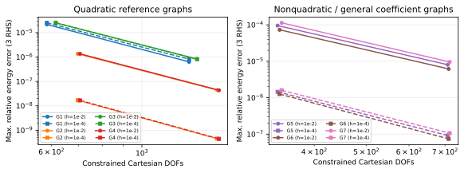
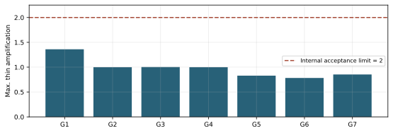
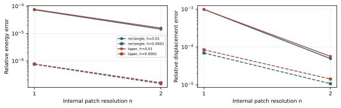

# 参照幾何から位置・厚さ勾配を対補完する曲面シェル離散化

Reference-geometry-based paired enrichment of position and transverse-gradient fields for curved-shell discretization

**UVLAS Technical Report / 第1稿 / 2026年11月6日**

**未査読。新規性の確定、厚さ一様収束の一般証明、実務適用の認定を主張するものではない。**

## 要旨

曲面シェルの変位近似では、局所で曲げ場を表現できても、共有条件と薄肉極限を同時に課した大域空間で必要な曲率変化を失う場合がある。本報告は、その問題を動機として構成した参照係数PG-ANCFを、一つの近似空間・変分・検証手順として記述する。多項式グラフの参照幾何と荷重非依存の曲率種から、中面位置と厚さ勾配を対として構成し、各成分をCartesianスカラー基底として展開する。参照再現、厚さ二次の位置近似、全3D弾性、一定整合質量、全厚さ位置トレースを保持する。膜ひずみ2成分と線形横せん断・法線ひずみの恒等式、剛体運動への閉性、全トレース持上げの核を仮定付きで示す。保存済み28配置84右辺の有限厚さ試験では、最細の最大相対エネルギー誤差は9.563215e-6、位置誤差は5.466687e-8であった。独立な体積力・全面力、2パッチ接続、積層非線形整合の証拠を分けて報告する。有限試験から任意曲面のlocking-free性や既存要素への優越は導かず、近接する先行研究との式レベルの比較と一般収束解析を残課題として明示する。

### Abstract

This report documents a reference-geometry-based paired enrichment for curved-shell approximation. Position and transverse-gradient fields are constructed jointly from polynomial graph geometry and load-independent curvature seeds. Their Cartesian scalar components form a fixed linear position space retaining three-dimensional elasticity, a constant consistent mass matrix, and full through-thickness position traces. Conditional differential and algebraic identities are derived, while the remaining membrane strain is retained. Archived finite-thickness approximation tests and independently prescribed body-force and traction problems are reported separately. The results support the tested construction; they do not establish general thickness-uniform convergence, superiority over existing elements, or practical validation. Scholarly novelty remains subject to a detailed prior-art comparison.

## 1. 問題設定と報告の位置付け

本報告の対象は、固定参照配置に対する曲面シェルの空間離散化である。UVLM、強連成時間法、flutter探索、CLI／配布の全体を一つの新理論として扱わない。PG-ANCFは本プロジェクト内の名称であり、公知の要素名や学術的な優先権を意味しない。最終の自由度は基底変換後のCartesian位置係数であって、通常の節点位置・傾きそのものとは限らない。そのため、ここでいうANCFは参照固定の線形Cartesian位置表示に基づく構成を指す。

対象とした設計要求は、曲面・歪み・変厚、全3D材料と積層、任意剛体運動、一定参照質量、物理界面の位置・仕事の整合である。これらを満たすために何を近似し、何を残したかを明確にすることが目的であり、新しい物理法則を導入するものではない。

薄肉曲げの動機を説明する模式的な線形エネルギーは次である。ここでhは厚さ、L₀は膜・横せん断等の主要な零次作用、L₁は曲げに関係する作用を表す。

$$
\Pi_h(u)\sim h\|L_0u\|^2+\frac{h^3}{12}\|L_1u\|^2,
\qquad h^{-3}\Pi_h(u)\sim h^{-2}\|L_0u\|^2+\frac1{12}\|L_1u\|^2. \tag{1}
$$

この式は全3Dエネルギーを置き換える製品モデルではない。共有後の離散空間に十分な曲げ方向がなければ、薄肉化に伴う罰則的な作用が誤差を増幅し得ることを示す説明である。膜作用素の核を離散近似が保存しないこととlockingの関係は既存研究でも議論されている[R2,R3]。

## 2. 先行研究と貢献候補

ANCFとそのシェル・板への展開には長い蓄積がある[R1]。DSGはひずみ差を用いたlocking対策[R2]、Regge補間は膜エネルギー側の制約緩和[R3]に関係する。近年のANCFシェルには、厚さ方向の高次導関数、一定質量、傾き不連続接続を扱う弱形式求積法[R4]、曲面の三角形要素[R5]、パラメータ化と高次連続性を用いる方式[R6]がある。変位のみ・3D材料・ひずみ場の追加を使わないsolid-shellも報告されている[R7]。近似空間を微分作用素で構成するmixed-displacement系の研究も比較対象である[R8]。

| 性質 | 本報告での位置付け |
|---|---|
| Cartesian位置表示、一定質量、全3D材料、厚さ高次展開 | 既存の考え方。これら単独の新規性は主張しない |
| 膜・せん断の整合を改善する空間／ひずみの設計 | 既存の広い研究領域。一般的な着想の発明は主張しない |
| 多項式参照からの具体的な対補完式と、そのスカラー化・全トレース構成 | 本報告の提案対象。既存方式との非同値性・学術的新規性は継続調査 |
| 厳密rankと幾何内積による同じ空間の条件付け | 数値構成の手順。正確演算や直交化自体の新規性は主張しない |
| 共有後の曲げ空間不足の診断と有限厚さの検証一式 | 本構成の根拠。普遍的収束定理や既存全要素の棄却ではない |

R4の公開プレプリントおよびR3の公開本文にはアクセスできた。R5/R6の確認は主に公開書誌・抄録であり、最終出版版の全式を照合済みではない。したがって本稿は「先行例が存在しない」という結論を出さない。調査範囲は付録Bに示す。

## 3. 参照配置、厚さ、未知量

持上げの導出は固定参照長L₀で無次元化した局所座標で示し、無次元量のhatは省略する。物理組立では長さ・面積・体積・勾配の尺度を戻す。パッチの参照中面と法線管を次で定義する。

$$
\mathbf r_0(s,t)=(x_0+ws+at,\ t,\ f(s,t)),\quad
\mathbf A_1=\mathbf r_{0,s},\quad
\mathbf A_2=\mathbf r_{0,t},\quad w>0, \tag{2}
$$

$$
\mathbf n=\frac{\mathbf A_1\times\mathbf A_2}{\|\mathbf A_1\times\mathbf A_2\|},\quad
z=H(s,t)\zeta/2,\quad
\mathbf X_0=\mathbf r_0+z\mathbf n,
\quad(s,t)\in D,\quad -1\le\zeta\le1. \tag{3}
$$

fはパッチ内の既知多項式、Hは正の実法線方向全厚、Dは矩形または正面積の多角形とする。検証プロファイルは総次数4以下のf、定厚または正の一次H、内部解像度n=1/2/4である。任意のCAD曲面・点別C² jetだけから同じ空間を構成できるとはしない。

参照Jacobian J₀にはHの面内微分を含める。単位法線管の局所正則性に対し、物理平面上のfのHessianの上界Bと最大厚さから、次の十分条件を使える。

$$
\theta=\tfrac12H_{\max}B<1,\qquad
\det J_0\ge\frac{wH_{\min}}2(1-\theta)^2>0. \tag{4}
$$

これは全域での局所Jacobianの十分条件であり、法線管の大域単射性や自己交差の不在を自動的に証明しない。適格性検査で未証明と反転実測を区別する。

位置は参照固定のスカラー形状関数のCartesian展開で表す。以下のqは物理座標へ戻した長さの係数であり、Nは無次元である。

$$
x_\alpha=\sum_{i=1}^{n_s}N_iq_{i\alpha},\qquad
N=R+zD+\tfrac12 z^2C. \tag{5}
$$

式(5)のR/D/Cは次数別の場を表す記号である。無次元の厚さを使う実装では対応するL₀の因子をD/Cへ含める。基底変換後の係数を、長さ・無次元傾き・逆長さの節点自由度へ混在して読み替えない。

## 4. 位置と厚さ勾配の対補完

### 4.1 参照係数の直接積分

一方向の曲率種k(s)に対し、原点を固定したモーメント積分を置く。kは荷重や計算解に依存させない。

$$
I_m(s)=\int_0^s u^mk(u)\,du,\qquad
b(s)=sI_0(s)-I_1(s),\qquad b''=k. \tag{6}
$$

単位幅・無歪み記法の補助場を次で作る。

$$
\widetilde v_1=-f(s,t)I_0(s)+\int_0^s f(u,t)k(u)\,du,\quad
\widetilde v_3=b(s), \tag{7}
$$

$$
\widetilde v_2=-s\int_0^s f_{,t}(u,t)k(u)\,du
                  +\int_0^s u f_{,t}(u,t)k(u)\,du. \tag{8}
$$

アフィンチャート(2)では、位置成分を次のように変換する。

$$
v_1=\widetilde v_1/w,\qquad
v_2=\widetilde v_2-a\widetilde v_1/w,\qquad
v_3=\widetilde v_3. \tag{9}
$$

fはチャート上の多項式そのものであり、柱面の曲率定数を点別曲率に置換する構成ではない。t方向族も、まず単位チャートでs/tと対応Cartesian成分を交換し、その後に式(9)を適用して構成する。

### 4.2 中面の線形膜ひずみ

中面の共変線形膜ひずみを次で定義する。

$$
\eta_{ab}=\tfrac12(\mathbf A_a\cdot\mathbf v_{,b}
                              +\mathbf A_b\cdot\mathbf v_{,a}). \tag{10}
$$

**命題1。** fが必要な微分を持ち、積分と微分を交換できる区間では、式(6)-(9)は次を満たす。

$$
\eta_{11}=0,\qquad\eta_{12}=0,\qquad
\eta_{22}=\widetilde v_{2,t}. \tag{11}
$$

**導出。** 微積分の基本定理から、ṽ₁,s=−f,sI₀、ṽ₃,s=I₀、ṽ₃,t=0となる。またJₜ=∫₀ˢ f,t k duとすると、ṽ₁,t=−f,tI₀+Jₜ、ṽ₂,s=−Jₜである。式(9)とA₁=(w,0,f,s)、A₂=(a,1,f,t)を式(10)へ代入すると、11および12成分が相殺し、22成分にはṽ₂,tが残る。残存成分は一般に零ではなく、後の3Dエネルギーから除かない。

これは2成分の恒等式であって、任意の二重曲面上の全ての曲げが等長になるという主張ではない。独立な記号微分でもアフィン幅・歪みを記号のまま保持して式(11)を確認した。

### 4.3 同じ位置場からdirectorを構成

厚さ勾配の補完dは、同じvに対して次の3本の条件から定める。

$$
\begin{bmatrix}\mathbf A_1^T\\\mathbf A_2^T\\\mathbf n^T\end{bmatrix}\mathbf d
=\begin{bmatrix}-\mathbf n\cdot\mathbf v_{,s}\\
                  -\mathbf n\cdot\mathbf v_{,t}\\0\end{bmatrix}. \tag{12}
$$

物理平面の勾配p=f,X、q=f,Y、g=1+p²+q²を使い、ℓ₁=v₃,X−pv₁,X−qv₂,X、ℓ₂=v₃,Y−pv₁,Y−qv₂,Yとすると、閉形式は次である。

$$
\mathbf d=-g^{-3/2}
\begin{bmatrix}(1+q^2)\ell_1-pq\ell_2\\
               (1+p^2)\ell_2-pq\ell_1\\p\ell_1+q\ell_2\end{bmatrix}. \tag{13}
$$

**命題2。** 単位法線と式(12)を用いると、u=v+zdの線形化した共変ひずみは、全厚さで横せん断と法線成分が零である。ただし式(11)の残る膜成分と厚さ依存曲げ成分は残る。

**導出。** zを独立座標としてGₐ=Aₐ+zn,a、G₃=n、u,a=v,a+zd,a、u,3=dである。したがって

$$
2e_{a3}=\mathbf A_a\cdot\mathbf d+
\mathbf n\cdot\mathbf v_{,a}
+z(\mathbf n_{,a}\cdot\mathbf d+\mathbf n\cdot\mathbf d_{,a})=0,
\qquad e_{33}=\mathbf n\cdot\mathbf d=0. \tag{14}
$$

最後のz係数はn·d=0の面内微分で零となる。ζを使う場合に加わるz,a項もn·d=0によって相殺する。命題は参照での線形ひずみに対するものであり、有限Greenひずみの二次項まで消えることは意味しない。

## 5. 有限なスカラー空間と境界トレース

### 5.1 辞書とCartesian展開

参照上の各方向を2n小区間に分け、各区間を支持とするLegendre次数0〜7の曲率種を用いる。種をその区間外で零として、式(6)を区間を越えて積分する。s/t両族、2n種区間、8次数、3成分から96n本の対のスカラー列を得る。

$$
\phi_j(s,t,z)=v_j(s,t)+zd_j(s,t),\quad j=1,2,3,
\qquad\phi_j\mathbf e_\alpha\quad(\alpha=1,2,3). \tag{15}
$$

各スカラー列は全3Cartesian方向へ展開する。式(11)-(14)を満たすのは特定の対の線形結合であり、各φⱼeαが個別に無伸長であるとは言わない。ベクトル場を一方向だけへ固定する補完では、任意剛体回転への閉性を別途失うおそれがある。

基礎辞書は、n分割のC¹二次tensor B-splineによる位置場、C⁰二次分子を√gで割った厚さ一次場、C⁰双一次の厚さ二次場を持つ。参照r₀のfと法線nの分子を補完する。独立な膜・せん断・法線変形を基本場から削除しない。トレース補完前の名目列数は

$$
n_R=(n+2)^2+1,\qquad n_D=(2n+1)^2+3,\qquad
n_{\rm pair}=96n,\qquad n_C=(n+1)^2. \tag{16}
$$

実際のnₛは、参照依存の重複・線形従属を除いた像の次元であり、式(16)の単純な合計ではない。多項式対のD分子はg³ᐟ²を共通分母として保持し、基本Dも分子にgを掛けて同じ辞書へ置く。必要微分は多項式係数から評価する。vの二階微分にはfの高階微分が現れ得るため、点別C²情報だけで代替しない。

### 5.2 全トレースとアンカー

アンカー面Γₐ={s=0}の全厚さ位置トレースをTₐとする。アンカーは空間準備の規約であり、物理的に常に固定される境界ではない。元辞書のスカラー空間Sに対し、TₐLₐ=Iを満たす固定持上げLₐを用いる。

$$
V=S+L_a(T_aS),\qquad H_a=(I-L_aT_a)S. \tag{17}
$$

具体的にはR、Dの共通分子、Cのアンカートレースを取り、それぞれ(1−s)を掛けて延長する。Dの分母はパッチ内のg(s,t)³ᐟ²で評価するので、物理D値そのものの単純な線形延長とは区別する。境界s=0では同じ分母へ戻り、右逆条件を満たす。

**命題3。** 式(17)について次が成立する。

$$
\ker(T_a|_V)=H_a. \tag{18}
$$

**導出。** u=s₀+Lₐt₀をVの任意元とし、Tₐu=0ならt₀=−Tₐs₀であるからu=(I−LₐTₐ)s₀となる。逆向きはTₐ(I−LₐTₐ)=0より従う。この右逆と核の関係は標準的な線形代数であり、その恒等式自体を新定理とはしない。

R4の同次支持試験はHₐを使用し、積層・剛体・接続の検査ではfull Vと別の物理拘束を使った。支持を変えるたびに物理空間をRitz最小解へ固定し直す方式ではない。

### 5.3 パッチ間の仕事

同じ物理界面上で、両側の参照位置・法線・全厚・層対応を確認して全位置トレースを結ぶ。

$$
Cq=c,\qquad
\delta W_\Gamma=\mathbf\lambda^TC\delta q,\qquad
Q_\Gamma=C^T\mathbf\lambda. \tag{19}
$$

同じ作用素とその転置を運動と力に用いる。中面の平均一致だけで全厚さを代表しない。参照チャートが異なる場合の係数を添字だけで等置しない。内部パッチのC¹中面表現と、パッチ間の全位置C⁰適合を区別する。折れ・厚さ段差・異なる法線を持つ部材接続には別の物理対応が必要で、今回の2パッチ例から任意接合の成立は導かない。

## 6. 係数の独立性と条件付け

RとDの分子を有理係数辞書へ置き、全セルの係数像のrankと、参照・並進・global曲率場の包含を確認する。Dの共通分母が非零で、厚さの0／1／2次が独立な参照管では、係数像の独立性が同じ関数空間の基底選択に使える。浮動小数点QRは候補行・列を選ぶ補助に使っても、選択後のrankは有理数で再確認する。

参照幾何内積による条件付けは、未知空間や実密度を変える操作ではない。局所基底変換Tに対して、離散の幾何Gram行列をMrefと書く。

$$
M_{\rm ref}=\sum_p w_p N(p)^TN(p),\qquad
\|T^TM_{\rm ref}T-I\|_\infty\le10^{-20}. \tag{20}
$$

幾何内積の合同変換と係数組合せを区間演算で囲い、組合せを完了してからfloat64へ変換する。係数組合せの半径基準は1e-25である。ほぼ零の高次成分との相殺を減らすため、再現すべき滑らかな部分空間を先に保持する。

式(20)の対象は指定求積のGram行列である。非多項式の幾何因子を含む連続積分全体の区間保証、物理剛性の条件保証、解精度の保証ではない。小さい特異方向を捨てるrank削減や擬似逆による正常化は行わない。全モデルの密RREF／密nullspaceではなく、有界patch内の準備として実装する。

## 7. 全3D変分、質量、剛体運動

物理参照勾配GᵢJ=Nᵢ,ξb(J₀⁻¹)bJを用いて、変形とGreenひずみを定義する。無次元Jacobianを使う場合はGに1/L₀、体積にL₀³を戻す。

$$
F_{\alpha J}=\sum_iq_{i\alpha}G_{iJ},\qquad
E=\tfrac12(F^TF-I),\qquad
U(q)=\sum_\ell\int_{\Omega_{0\ell}}W_\ell(E,E_{0\ell})\,dV_0. \tag{21}
$$

層の固定参照材料軸、指定初期ひずみ、第二PK応力S、第一PK応力P=FSを用いる。主経路で平面応力Schur消去、ANS/EAS、人工安定化を追加しない。これはそれら既存手法の一般的な否定ではなく、本構成の物理・数値モデルの選択である。

$$
f_{i\alpha}=\sum_\ell\int G_{iJ}P_{\alpha J}\,dV_0,\qquad
M_{i\alpha,j\beta}=\delta_{\alpha\beta}\sum_\ell\int\rho_{0\ell}N_iN_j\,dV_0. \tag{22}
$$

Mandel基底で材料接線をCᴹ、ひずみ変分をBとすると、接線は材料項と幾何項を共に含む。

$$
K_{i\alpha,j\beta}=\sum_\ell\int
\left[B_{k,i\alpha}C^M_{kl}B_{l,j\beta}
+\delta_{\alpha\beta}G_{iJ}S_{JL}G_{jL}\right]dV_0. \tag{23}
$$

**命題4。** 参照、材料密度、基底が固定される限り、式(22)のMはqに依存しない。また、Nτ=1およびNq₀=X₀を再現するfull空間では、任意の固定剛体運動に対して空間が閉じる。

$$
q'_{i\alpha}=Q_{\alpha\beta}q_{i\beta}+\tau_i c_\alpha
\quad\Longrightarrow\quad x'=Qx+c,\quad F'=QF,\quad E'=E,
\qquad Q\in SO(3). \tag{24}
$$

**導出。** 式(5)の線形性と参照固定性から直ちに従う。固定支持を保った同次部分空間に全剛体運動が残るという意味ではない。支持と参照も対応する変換を行った力学系についての性質である。梁・剛体・非線形拘束への座標変換が生む状態依存慣性は、シェルMの定数性から消えない。

## 8. 数値評価の定義

### 8.1 曲げ近似試験

線形等方3D弾性Eyoung=1、ν=0.3を用いる。独立参照は、連続の曲率k(s)=1/(1+α²s²)と式(6)-(13)から構成する。G1〜G4はα=2/4/6、G5〜G7はα=3/5/7の3右辺とし、主基底の区分P7そのものを正解場にはしない。G1〜G4はn=2/4、G5〜G7はn=1/2、各々h=0.01/0.0001を用いた。

G1〜G6の元の物理グラフは次で定義する。チャートが歪む場合はX=x₀+ws+atを代入してf(s,t)を得る。

$$
\widetilde f(X,Y)=\frac{\kappa_x}{2}X^2+\frac{\kappa_y}{2}Y^2+
\tau XY+\frac{c_x}{3}X^3+\frac{c_y}{3}Y^3+mX^2Y^2. \tag{25}
$$

| 群 | (κx,κy,τ,cx,cy,m) | (x₀,w,a) | H/h |
|---|---|---|---|
| G1 | (.4,0,0,0,0,0) | (0,1,0) | 1 |
| G2 | (.4,.2,0,0,0,0) | (0,1,0) | 1 |
| G3 | (.4,0,.07,0,0,0) | (0,1,0) | 1 |
| G4 | (.4,−.2,.07,0,0,0) | (0,1,0) | 1+.1s+.05t |
| G5 | (.4,.2,.07,.1,−.06,.025) | (0,1,0) | 1+.1s+.05t |
| G6 | (.4,.2,.07,.1,−.06,.025) | (0,.8,.2) | 1+.1s+.05t |
| G7 | 式(26) | (0,1,0) | 1+.1s+.05t |

$$
\begin{aligned}
f_7={}&s^2/5+t^2/10+7st/100+s^3/30-t^3/50+s^2t^2/40\\
&+7s^4/1000-t^4/100+3s^3t/250-st^3/125+9s^2t/1000.
\end{aligned} \tag{26}
$$

アンカー面の全位置を同次に固定し、次の弾性内積で参照u★のGalerkin射影を求める。これは一般外力の非線形PDE解そのものではなく、有限厚さでの近似性検査である。

$$
a_h(u,v)=\int_{\Omega_0}\varepsilon(u):\mathbb C:\varepsilon(v)\,dV_0,
\qquad a_h(u_h,v_h)=a_h(u^\star,v_h)\quad\forall v_h\in H_a^3. \tag{27}
$$

$$
e_E=\sqrt{\frac{a_h(u_h-u^\star,u_h-u^\star)}{a_h(u^\star,u^\star)}},\qquad
e_x=\frac{\|u_h-u^\star\|_{L^2(\Omega_0)}}{\|u^\star\|_{L^2(\Omega_0)}}. \tag{28}
$$

算術的な相殺を減らすため、空間に含まれるglobal P7曲率8場へ参照を先に射影し、その残差を解く。最終観測はcoarse成分を加えた全場で行い、分母も元の参照場である。coarse包含を別に確認しているので空間を増やす操作ではないが、誤差が小さいことは、この特定の滑らかな参照群が十分近似されることを示すにとどまる。

主求積は面内のD分子次数+3、観測は+5、厚さはそれぞれ7点／9点である。全24運動学jetを保持するQRにより同じ3D作用を圧縮し、特異列の切捨てはしない。質量は厚さ4点と7点を照合した。面内の非多項式幾何因子について、厚さ方向の多項式厳密性を流用しない。

### 8.2 判定と薄肉増幅

プロジェクト内の事前選別条件は、最細のeE/exが各1%以内、細分化による非増加、2厚さ間の誤差増幅2倍以内、原停留1e-8以下である。これらは本試験の選別条件であり、学術的なlocking-free性の定義や外部規格ではない。誤差比は次の床付きで観測した。

$$
\mathcal A_e=\frac{\max(e(h=10^{-4}),10^{-12})}{\max(e(h=10^{-2}),10^{-12})}. \tag{29}
$$

2厚さ・2解像度の有限比較であるため、h→0で一様なCéa定数や任意格子列の収束次数を推定しない。数値床以下の位置誤差から厳密な次数も算出しない。

## 9. 結果

### 9.1 28配置・84右辺

表1のエネルギー／位置は各群の最細で全厚さ・3右辺に対する最大値、薄肉比は各群の両解像度・両観測に関する元の右辺別比の最大値である。DOFは同次支持後のCartesian係数数である。

| Group | finest n | DOFs | max energy | max position | max thin ratio* |
|---|---:|---:|---:|---:|---:|
| G1 | 4 | 1305 | 8.193649e-07 | 1.022500e-10 | 1.360525 |
| G2 | 4 | 1530 | 4.410056e-08 | 1.117758e-10 | 1.000000 |
| G3 | 4 | 1365 | 8.196357e-07 | 1.101195e-10 | 1.003037 |
| G4 | 4 | 1545 | 4.343268e-08 | 1.076631e-10 | 1.000000 |
| G5 | 2 | 708 | 8.035147e-06 | 5.466687e-08 | 0.829496 |
| G6 | 2 | 711 | 6.156903e-06 | 5.386094e-08 | 0.783333 |
| G7 | 2 | 714 | 9.563215e-06 | 5.412052e-08 | 0.853473 |

*表1：保存された射影品質結果の再集計。薄肉比は式(29)の定義であり、漸近上界ではない。*



最細最大eEは9.563215e-6、exは5.466687e-8、全配置の原停留最大は7.449075e-12である。元のrank検査、参照包含、固定トレース、質量正則性の条件も保存結果では成立している。



### 9.2 独立な体積力・全面力

射影試験と別に、微小ひずみ等方弾性の解析場u★=(A X²,0,0)、A=0.01からσ★、b★=−divσ★、t★=σ★n₀を定義した。組立済みKqを右辺の生成に使っていない。

$$
\varepsilon_{XX}^\star=2AX,\quad
\sigma^\star=2AX\,\mathrm{diag}(\lambda+2\mu,\lambda,\lambda),\quad
\mathbf b^\star=(-2A(\lambda+2\mu),0,0),\quad
\mathbf t^\star=\sigma^\star\mathbf n_0, \tag{30}
$$

$$
\mu=1/2.6,\qquad \lambda=0.3/(1.3\cdot0.4). \tag{31}
$$

グラフは式(25)の(.4,.2,0,.1,−.06,.025)、変厚H=h(1+.1s+.05t)で、矩形D=[0,1]²と台形D={0≤s≤1, .3s≤t≤1−.1s}を用いた。各n=1/2、h=.01/.0001。s=0の全厚さ位置を固定し、他の外面へ解析tractionを与える。固定面も含む全面の仮想仕事・釣合いを別に観測した。

| Domain | n | h | energy | position | original stationarity | load agreement |
|---|---:|---:|---:|---:|---:|---:|
| rectangle | 1 | 1e-02 | 7.361892e-05 | 9.918454e-04 | 6.313e-16 | 3.168e-13 |
| rectangle | 1 | 1e-04 | 7.544520e-07 | 6.974498e-05 | 3.341e-14 | 3.865e-10 |
| rectangle | 2 | 1e-02 | 1.442369e-05 | 4.927876e-05 | 7.011e-16 | 6.411e-13 |
| rectangle | 2 | 1e-04 | 1.478420e-07 | 1.072600e-05 | 3.551e-14 | 1.640e-09 |
| taper | 1 | 1e-02 | 7.626405e-05 | 9.885157e-04 | 5.814e-16 | 3.528e-13 |
| taper | 1 | 1e-04 | 7.781351e-07 | 8.462335e-05 | 1.392e-14 | 6.490e-10 |
| taper | 2 | 1e-02 | 1.582504e-05 | 5.650556e-05 | 6.324e-16 | 1.245e-12 |
| taper | 2 | 1e-04 | 1.601476e-07 | 1.425346e-05 | 2.691e-14 | 2.095e-09 |


*表2：独立荷重の小ひずみPDE比較。load agreementは物理荷重解と独立弱積分解のエネルギー尺度差であり、連続解への誤差とは別。*



台形の初回試験では先端側面の積分区間が背景セル境界と一致せず、原停留条件を満たさなかった。背景の実際の交点で分割し、同じN・剛性因子・尺度・閾値で再評価したv2を表2に用いた。旧未達は保存している。これは空間の改良ではなく、区分場に対する面求積の訂正である。

### 9.3 接続・有限変形・積層の整合

同じ非二次物理グラフをX方向に2パッチへ分け、各チャート幅.5、厚さ.05、内部分割(1,1)および非整合(1,2)で全位置を接続した。独立Cartesian一定ひずみと全面tractionからの線形PDE解、別点での全厚さ位置、同じ拘束転置の仕事を照合した。これは同一の滑らかな物理界面の2例であり、任意の折れ・交差・層ずれ接続の証明ではない。

有限変形の整合試験はfull V、n=1、非二次グラフ、H=.05(1+.1s+.05t)、異方性2層・初期ひずみを使う。エネルギーの方向微分、内力接線、重ねた剛体回転、同一層の再分割、層界面両側回復、Newton復帰、質量・符号付き固有値を個別に確認した。

| 確認 | 保存結果の代表値 | 分かる範囲 |
|---|---:|---|
| 非線形エネルギー方向微分 | 1.255058e-15 | 同じ材料モデルの変分整合 |
| 内力の方向微分と接線 | 4.206028e-15 | 指定状態・方向の接線整合 |
| 重ねた剛体回転の力 | 1.024690e-11 | 指定有限変形状態の客観性 |
| 別体積求積45→49のK差 | 9.287067e-14 | 当該配置・状態の求積感度 |
| 2パッチの原平衡（1,1） | 6.807067e-15 | 原系の数値平衡 |
| 同・界面仕事差 | 2.211207e-16 | 指定界面・変分の双対整合 |

これらは有限変形の独立実験validationではない。材料lawを共有する微分照合と、独立な境界荷重／別求積が検査する誤りの種類を分ける。state・慣性の検査も、本報告で製品の時間積分やflutter予測を認定する根拠にしない。

## 10. 費用、実装への含意、再現性

有界patch内の独立係数数をnₛとすると、局所密因子の保持はO(nₛ²)、準備はO(nₛ³)、明示Kの点積分はO(np nₛ²)を目安とする。K作用と疎な接続を使える。原KKTは次の形を保持し、製品規模で全域の密nullspaceを必須にしない。

$$
\begin{bmatrix}K&C^T\\C&0\end{bmatrix}
\begin{bmatrix}\Delta q\\\Delta\lambda\end{bmatrix}
=-\begin{bmatrix}f-f_{\rm ext}+C^T\lambda\\Cq-c\end{bmatrix}. \tag{32}
$$

28配置での最大154.313秒は、準備cacheに含まれる初期構成時間を加算したcold-case指標であり、別環境との比較や製品の一体接続性能を示さない。独立部材集合の100800座標の容量試験も、結合graphのfill・前処理・全探索性能とは区別する。既存要素に対する費用優位の比較は今回行っていない。

本稿の図表は保存済みresultを読んで生成した。新たな大型FEM計算・幾何調整・物性同定は行っていない。主な構成コードと根拠は付録Aに示す。新しい6つの記号恒等式確認は既存のPG評価kernelを呼ばないが、本文導出の一般収束解析を置き換えない。

## 11. 限界と投稿論文化へ残る課題

第一に、本稿は参照係数空間の具体構成と限定検証であり、任意曲面・任意歪み・任意薄肉極限での安定性／収束定理を持たない。多項式グラフと2解像度・2厚さの良好な結果を、全域のlocking-free性と呼ばない。残るη₂₂と有限Greenひずみの二次項は実際のエネルギーに残る。

第二に、従来候補の共有核不足は本構成への動機であり、全ての既存ANCF／solid-shellが要求を満たせないという証明ではない。R4〜R8を含む近接手法との式・変数変換・空間の包含／非同値性を精査する必要がある。

第三に、標準シェル問題、代表既存要素との同条件の精度／DOF／費用比較、より広い厚さ・格子系列が未実施である。まず現在の近似空間を変えず、膜支配・曲げ支配・混合問題の小さな比較群を事前に固定する。既存手法に不利な条件や今回の参照場だけで優越を主張しない。

第四に、参照曲面近似・痩せた切断領域・大域接合・外部格子変換・疎構造の準備／分解費用は、単一patchの結果から保証できない。実験、実務材料の不確かさ、製品性能・配布は別の受入である。

投稿論文へ進む条件は、(i)近接先行研究との式レベルの照合、(ii)主張と証明／数値証拠の対応の独立専門家レビュー、(iii)標準問題と代表既存方式との比較、(iv)再現bundleを別環境で実行する確認、(v)著者・貢献・公開条件・投稿先の確定である。現段階で論文採択可能性や世界初を保証しない。

## 12. 結論

参照多項式から位置と厚さ勾配を対で構成し、そのスカラー成分をCartesian展開する曲面シェル空間を記述した。2つの膜成分と線形横せん断／法線成分の条件、参照再現、剛体運動への閉性、一定質量、全トレースの核を明示した。保存済み有限厚さ近似と独立PDE荷重は、指定条件での実装・近似の根拠を与える。新規性、一般一様収束、他要素に対する優越、実務性能は結論に含めない。本報告は、本体実装とそのレビューが同じ空間・変分・検証対象を共有するための技術的基準となる。

## 付録A. 構成・検証・再集計の対応

相対パスはUVLASリポジトリrootを基準とする。本文の理論・結果の正本を以下へ対応付ける。`source-hashes.json`に本文で参照したファイルと新しい図表のSHA256を保存する。

| 対象 | 構成／検証の正本 |
|---|---|
| 最終採用範囲 | docs/specs/structure/main-shell-adopted-specification.md |
| 一般多項式持上げ・原辞書・trace | rd/structure/main-shell/paired-geometry/experiments/general_paired_polynomials.py |
| 基底準備・幾何Gram・区間検証 | rd/structure/main-shell/paired-geometry/experiments/mass_paired_ancf.py |
| 参照グラフ・実法線厚さ | rd/structure/main-shell/polynomial-trace/experiments/polynomial_reference_surface.py |
| 独立曲率参照 | rd/structure/main-shell/paired-geometry/experiments/general_paired_fields.py |
| 3D作用・主求積／別観測 | rd/structure/main-shell/paired-geometry/experiments/exact_paired_finite.py |
| 28配置の原結果 | rd/structure/main-shell/paired-geometry/records/mass-paired-quality-result.json、mass-paired-coefficient-input-result.json |
| 独立PDEと台形訂正 | rd/structure/main-shell/paired-geometry/records/mass-paired-body-result.json、paired-shell-r5-domain-v2-result.json |
| 接続／非線形／向き | rd/structure/main-shell/paired-geometry/records/mass-paired-interface-result.json、mass-paired-mechanics-result.json、mass-paired-orientation-result.json |
| 新しい記号確認・集計・図 | rd/structure/main-shell/paired-geometry/report-tools/prepare_pg_ancf_report.py、docs/papers/pg-ancf-assets/ |

原結果のsource／artifact hashを照合してから再集計する。数値実験の元スクリプトには旧成果物の上書き防止があるため、再実行は別の出力場所を持つ作業用checkoutで行い、旧resultを消して上書きしない。現在の再集計コマンドは次である。

```text
build/design-fem-env/Scripts/python.exe rd/structure/main-shell/paired-geometry/report-tools/prepare_pg_ancf_report.py --output-dir build/paper-regeneration-YYYYMMDD
```

再集計に必要なのはNumPy 2.3.5、SymPy 1.14.0、Matplotlib 3.10.7。既存の元試験の再生成にはSciPy 1.16.3、python-flint等も必要で、元記録の環境を参照する。図表・記号計算・PDF組版の新規成果物と、変更していない元の数値試験を区別する。

## 付録B. 先行研究の確認範囲

2026年11月6日時点の初期照合であり、包括的な新規性調査ではない。検索軸はANCF曲面／厚さ展開、geometry-dependent enrichment、membrane/shear locking、kernel preservation、mixed displacement、solid-shellである。公知手法の用語だけでなく、式・空間の同値性を今後確認する。

| 文献 | 今回確認した範囲 | 残る照合 |
|---|---|---|
| R1 | 著者公開の書誌／reviewの位置付け | 引用された原要素との式比較 |
| R2 | 出版社の公開要旨・書誌 | 変位変換／ひずみ差の詳細 |
| R3 | 公開本文のkernel条件・Regge補間・評価例 | 提案空間との機能解析上の関係 |
| R4 | 公開preprintの要旨・厚さ展開・接続／検証の該当箇所 | 最終版との差分、全式・実装の同条件比較 |
| R5 | 出版社の公開要旨・書誌 | 形状関数・EAS/ANS・対象曲面の全式 |
| R6 | 出版社の公開要旨・書誌 | parameterization／補間と本空間の非同値性 |
| R7 | 著者公開preprintの要旨 | 階層形状関数・厚さ構成・費用の詳細 |
| R8 | 研究機関の公開説明と関連文献一覧 | mixed-displacement等の原論文・作用素との比較 |

## 参考文献

[R1] K. Otsuka, K. Makihara, H. Sugiyama. Recent Advances in the Absolute Nodal Coordinate Formulation: Literature Review From 2012 to 2020. Journal of Computational and Nonlinear Dynamics, 17(8), 080803, 2022. [DOI](https://doi.org/10.1115/1.4054113)、[著者公開版](https://researchmap.jp/keisuke_otsuka/published_papers/36395648/attachment_file.pdf)。

[R2] F. Koschnick, M. Bischoff, N. Camprubí, K.-U. Bletzinger. The discrete strain gap method and membrane locking. Computer Methods in Applied Mechanics and Engineering, 194(21-24), 2444-2463, 2005. [DOI](https://doi.org/10.1016/j.cma.2004.07.040)。

[R3] M. Neunteufel, J. Schöberl. Avoiding Membrane Locking with Regge Interpolation. arXiv:1907.06232v3, 2020. [公開本文](https://arxiv.org/html/1907.06232v3)、[関連journal DOI](https://doi.org/10.1016/j.cma.2020.113524)。

[R4] Z. He, H. Li, H. Zhong. Weak form quadrature shell elements based on absolute nodal coordinate formulation. Thin-Walled Structures, 206, 112670, 2025. [Journal DOI](https://doi.org/10.1016/j.tws.2024.112670)。今回参照した公開preprintは2024年2月28日、[DOI:10.21203/rs.3.rs-3945984/v1](https://doi.org/10.21203/rs.3.rs-3945984/v1)。最終版の全式を確認したとは扱わない。

[R5] B. Zhang, W. Fan, H. Ren. A New Triangular Thin Shell Element Based on the Absolute Nodal Coordinate Formulation for Complex Surfaces. Journal of Computational and Nonlinear Dynamics, 20(1), 011001, 2025; online 2024年10月18日. [DOI](https://doi.org/10.1115/1.4066572)。

[R6] Y. Liu, W. Fan, H. Ren, Z. Chen. A universal parameterized absolute nodal coordinate formulation for arbitrarily shaped shells. Thin-Walled Structures, 213, 113307, 2025. [DOI](https://doi.org/10.1016/j.tws.2025.113307)。

[R7] L. Kaczmarczyk, H. Nguyen, Z. Ullah, M. Wakeni, C. Pearce. Solid shell prism elements based on hierarchical, heterogeneous, and anisotropic shape functions. arXiv:2010.08799v1, 2020. [著者公開preprint](https://arxiv.org/abs/2010.08799)。

[R8] Institute for Structural Mechanics, University of Stuttgart. Intrinsically locking-free formulations. [研究機関の公開説明](https://www.ibb.uni-stuttgart.de/en/research/current-research-projects/intrinsically-locking-free-formulations/)、2026年11月6日確認。査読論文そのものではなく、近接する原論文を探索するための情報として使用。

### 作成・版の注記

本稿は既存の設計記録を、生成AI支援による草稿整理・独立記号計算・保存結果の再集計で統合した技術報告である。著者名・投稿先・査読・公開識別子は未設定であり、作成していない。採否済みの元証拠と製品仕様を本稿によって書き換えない。独立した専門家レビューおよび投稿用の最終責任確認は未実施である。
