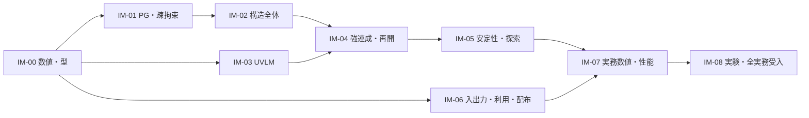

# 実装開始審査と実装パッケージ

2026-11-06。実装前作業6の開始判定。**最初の製品実装パッケージIM-00は着手可能。** これは部分リリースの承認でも、全実務ケースの受入完了でもない。採用方式1〜4と受入計画5を前提に、内部実装を開始する。

## 1. 開始条件8項目への対応

| 条件 | 根拠・判定 |
|---|---|
| 系全体の問題と責任 | [連成問題](../specs/coupled-problem-definition.md)、[構造](../specs/structure/structural-adopted-specification.md)、[UVLM](../specs/aero/uvlm-integrated-specification.md)、[J1](../specs/coupled/coupled-adopted-specification.md)。物理・未知量・時間・仕事が接続済み |
| 採用式・規約・初期境界 | 主シェルSH-D01〜08、構造ST-01〜10、空力AE-01〜07、J1-D01〜09。初期微分と受理後荷重は[J1追加規約](../specs/coupled/j1-initialization-output-derivative-addendum.md)を優先。過去のEuler／BDF1試作を製品仕様へ戻さない |
| 型・形状・所有権・失敗 | [N4-02/03/08](../specs/foundation/numerical-foundation-adoption-specification.md)、[IO4](../specs/foundation/io-execution-adoption-specification.md)。64bit layout、精度buffer、親／試行／確定、Workspace、expected／Failureを定義 |
| 処理・履歴・微分・cache | J1の一括残差・Newton・全状態P、N4の解法・世代・原子確定、IO4の保存。必要微分と現在の受理D_hΓを明示 |
| 入力・参照・不変条件・許容差 | [受入計画A5](../requirements/practical-acceptance-plan.md)、[19ケース・37要求の対応](../../rd/acceptance/plan/records/practical-acceptance-case-catalog.json)。最初の数値移植には既存の凍結した独立参照と負対照がある |
| 依存・性質・容量・限定試作 | [4の終了判断](../../rd/foundation/numerics/records/numerical-foundation-adoption-completion.md)。両OSの数値・binding、64bit疎、精密消費、実J1行列と容量を確認。全製品性能は未測定で、下記の早期gateを必須とする |
| 要求からケースへの追跡 | 各採用仕様の決定ID→N4／IO4処理→V/X/Pケース。全37製品要求に計画上の対応がある。対応の存在を合格結果に数えない |
| 残課題と影響範囲 | 下記R-01〜07。IM-00の数式・型・失敗契約を未決定にする課題はない。実験認定・性能・実入力変換は該当パッケージでgateし、未達のまま製品受入へ進めない |

全製品の細部・実験結果が事前に存在するという判定ではない。開始判定は[実装前計画8節](../../rd/planning/preimplementation-plan.md)に従う最初の依存閉包である。理論・主要I/Fを決めず単体コードだけを既成事実化する段階は既に終えている。

## 2. 最初のパッケージIM-00

対象はC++23製品の数値表現・求解・状態契約の共通基盤。公開APIの互換性はまだ固定しない。

1. 既存のWindows／Linux構築へ版固定のEigen／Spectra／Boostを組み込み、取得hash・機能・license noticeを検査する。CMakeのネットワーク無断最新版取得を使わない。
2. strong ID、checked 64bit dimension、列優先密／CSC疎、成分／単位／尺度のlayout、PrecisionBuffer、Failure／Certificateを実装する。
3. 原系・原残差を保存する密／疎基準解法、実LU＋複素後縁更新、固定前処理GMRES、two-product／補償残差／two-word保持と明示投影を実装する。条件推定値を保証上界と誤用しない。
4. 不変Model参照・所有する結果・Workspace・cache世代・親／試行／資格／一回確定の型を実装する。製品のq／後流の具体kernelを先走って追加しない。
5. 設計spikeの4数値群とbindingの所有権／エラー規約を製品の実処理へ移植する。spike実行の成功を製品testの成功に置換しない。

入力はN4のOperator/Rhs/Scales/Precision/Limitsと、既存fixtureで構成される系。出力は所有するSolution/CertificateまたはFailure。成功時も親状態を書き換えない。空系・ゼロ右辺・非有限・特異・世代不一致・予算不足・投影未達を区別する。

最初の変更範囲はルートCMake、依存lock／取得補助、`include/uvlas`／`src`の共通数値型・求解、対応`tests`。既存の採用証拠・試作・result JSONを編集しない。製品型と実装は`rd`から明示的に移植し、検証コードのグローバル差替えや密全体nullspaceを流用しない。

終了条件：両OSのclean build、製品経路での元残差と既知解／完全固有値照合、強い型と世代・予算・投影の負対照、失敗時の親不変、ソース／依存／実行条件の追跡が通ること。小系で1e−12級の既存基準を維持し、元の精密保持・float64投影未達例も正しく拒否または認定する。全消費kernelは後続で移植し、未対応精度を正常終了にしない。

## 3. 後続パッケージと依存

| ID | 実装するもの | 依存と完了gate |
|---|---|---|
| IM-01 | PG参照係数・正確rank・持上げ・有界patch、層／面／全トレース、局所準備と疎大域chart | IM-00。V-PG、固定・剛体・位置／法線／厚さ・仕事、J/Jᵀ、実接続graphの準備／fill容量を通す |
| IM-02 | 3D材料・積層・初期ひずみ、梁・接続・支持・慣性、全外力・減衰・回復 | IM-00/01。V-MAT／BEAM／JOINT／LOAD／RECOVER、同じ平衡のM/K/C、非対称接線、全反力 |
| IM-03 | UVLM核・近接・共有辺・幾何・全荷重・後流・TE所有、全JVP／VJP | IM-00、写像はIM-01/02。V-AERO／V-MULTI内の写像、同じ有限核と理想参照、不確かさを含む数値予算 |
| IM-04 | J1初期化・強連成BDF2・新生台形、試行／確定・typed checkpoint | IM-01〜03。V-J1／STATE、二次収束、初期境界政策、全微分／全荷重、同一版bitwise再開 |
| IM-05 | 同じ離散平衡・全履歴P/P*、静的継続、固有抽出・mode／branch・速度探索 | IM-04。V-SEARCH、全行列／時間照合、被覆・誤差認定、静的発散／寄生rootの区別 |
| IM-06 | JSON／parametric／Nastran／Gmsh、準備・診断・CLI／Python／結果・配布 | 基盤入口はIM-00後、各物理変換は対応IM後。V-USE／STATE、両入力経路の同一物理、fresh環境、所有権・非互換拒否 |
| IM-07 | P-CURVED-BOX、全必須用途の独立FEM／時刻／mode／運用、実graphと全後流の性能改善 | IM-01〜06。A5全数値予算、95k〜105k＋5000、48GiB／12h。未達なら性能・近似を再設計し再認定 |
| IM-08 | 公開実験の参照認定とvalidation、要求対応・利用可能範囲・実務初回受入 | 参照調査は継続、実行は対応物理IM後。S10等の不確かさ・入力／校正履歴を認定し、実験差＋不確かさで判定 |

IM-01以降は先行パッケージの製品検証完了を入口条件とする。必要なのはその依存gateの検査であり、同じ方式候補の探索やユーザーの同じ決定を繰り返すことではない。修正が採用式・品質・実務範囲を変える場合は採用審査へ戻る。内部のroutine実装選択は自律的に進める。

## 4. リスク・未完了と止める位置

| ID | 残る課題 | 影響／停止条件 |
|---|---|---|
| R-01 | S10の測定・入力・同期・幾何の不確かさ、fixture／質量、marker・strain位置、校正履歴 | IM-08のExperimentQualifiedと実務受入を保留。測定値を推測せず、データ公開照会は外部送信の前に利用者判断。IM-00の型・式には影響しない |
| R-02 | 結合PGの疎拘束rank・chart分解fill・準備費用 | IM-01の早期gate。小さいrank方向の削除・大域密基底へ逃げない。製品規模に達する前に疎symbolicと容量を測る |
| R-03 | 全自由後流と全履歴P作用が支配する費用 | IM-03〜05で実際の相互作用数・分解再利用・Arnoldi memoryを測る。12h見込みが立たなければ直接基準を残し、高速化／近似と誤差認定を再設計。製品性能達成の見通しを今回の合成LUから断定しない |
| R-04 | TwoWord値を必要とする全kernelと再開の消費 | IM-00の型と認定は固定。対応consumerは各IMで検証。未対応をfloat64へ黙って落とさず精度未解決。初回製品は要求ケース全体で閉じるまで受入しない |
| R-05 | 外部格子から適格な共通曲面／厚さ・材料／接続への変換 | IM-06の準備gate。入力不足はsidecar要求または拒否。元FEMの回転DOFをPGへ直写ししない |
| R-06 | manylinux／Windowsの配布ランタイムと新規環境 | IM-06の初期から小さな製品wheel／CLIを作って検査。WSL成功だけで配布互換としない |
| R-07 | 固有mode被覆、P-CURVED-BOXの臨界区間と全数値予算 | IM-05/07。未認定の速度を安定と断定しない。性能ケースの版・入力を計測前に固定し、臨界なしのcaseを臨界予測の受入に使わない |

これらは消えた課題ではない。最初の実装の式・契約を変更しない課題と、該当領域の製品検証／実務受入を止める課題として位置を固定した。実務リリースを小規模サンプルや部分APIの公開で代替しない。

## 5. 開始判定

**実装前作業1〜4の方式・契約採用、5の実装後受入計画、6の最初の依存閉包審査を終え、IM-00から製品実装に着手できる。** 追加のroutine承認待ちは置かない。以後は上表の順と依存で実装・検証を進め、未達を解消してから次のgateへ進む。

「全実務要求の品質・性能が成立した」「S10の実験参照認定が終わった」「既に計算本体を実装した」とは判定していない。公開・実務適用はIM-08と全必須要件の受入後である。
