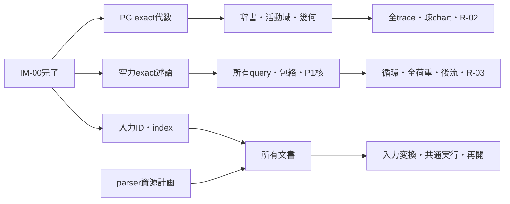

# 構造・空力・入出力を、開始条件の閉じた単位から実装する

2026-11-17。基準はPR #81〜#84を取り込んだ `a5eea5369f9b10f25aa96b457cf6e3555255b6f6`。既存のIM01-0・IM03-0・IM06-0を分解する計画であり、製品の方式・必須範囲・精度は変更しない。現在の行と状態は [ロードマップ](../roadmap.md)、各行の完了条件はIssueが持つ。

## 最初の3件と、開始を止める条件

| 子Issue | 実装する依存閉包 | 開始審査と後続への境界 |
|---|---|---|
| [#87](https://github.com/YUKIKEDA/UVLAS/issues/87) | PG参照準備用のexact有理数・二変数疎多項式 | [PG係数契約](../specs/structure/pg-coefficient-contract.md)の2.1/5/6/7節。具体型、bit・項・指数の上限、固定Boostのcapacity増設・gcd・除算・乗算・変換の同時領域を数える式を独立レビューしてから実装する。辞書やPreparedPatchの完成ではない |
| [#86](https://github.com/YUKIKEDA/UVLAS/issues/86) | 有限三角形の厳密な退化・内外・距離二乗・far述語 | [局所幾何契約](../specs/aero/local-geometry-contract.md)の5/7/9/10節。具体型、式別の整数bit上限、外部scratchの推定と未証明の区別、独立有理oracleを審査してから実装する。内部の準備部品であり、物理incidenceや法線包絡を認定しない |
| [#85](https://github.com/YUKIKEDA/UVLAS/issues/85) | 確保を伴わない厳格な入力ID・index変換 | [入力文書契約](../specs/foundation/input-document-contract.md)の整数・型・失敗の意味から開始可能。復号済みASCII文字列とnative整数だけを受け、既存の強いID/Indexと所有診断を返す。source/hash・JSON文書・有効caseを作らない |

IM-00の完了は [終了判定](im00-package-acceptance.md)で確認済み。3件の入力・返値・独立参照に相互依存はない。PGと空力の資源審査は、それぞれの子Issueの開始条件であり、入力変換まで待たせない。数学的bit上限を、Boostの確保byteやRSSの証明へ読み替えない。推定で受理する要求と、証明済み上界を要求する場合を区別する。

着手するIssueは、後続が使う入口から結果を受け取るまでを一つの到達点にする。検証では、その入口から呼び出して、正常値・所有権・失敗を確かめる。差分を分ける必要があれば依存順にPRを積み、入口から結果まで確認して一度に提示する。統合状況は [進捗表](active-package-progress.md) を参照する。

以下の表は親Issueが保持する全体の依存と停止条件である。各段階は、全必須能力を落とさず実装単位を決めるために使う。本書で子Issueを明示していない段階を、起票済み・着手済み・開始審査済みとは扱わない。親を閉じる前に全段階の実装・検証と子Issueの閉鎖を確認する。

## 最初の3件を取り込んだ後の実装

PR #89〜#91はmain `0f201a39dfb849115f90c559fec67f13e75c7645`へ統合済み。最初の3子作業の実装適合を次の入力とする。全PG空間、誘導核、物理caseの認定を済ませたという意味ではない。

| 子Issue | 入力 → 今回の成果物 | コード開始前に確認するもの |
|---|---|---|
| [#94](https://github.com/YUKIKEDA/UVLAS/issues/94) | exact代数 → 有理グラフ、全half-cell、明示片側・微分尺度、矩形活動map | graph内容identityの所有・canonical化、完全参照identityとの境界、一つのcallの入力/出力/最大scratchを集計する資源式。全辞書・多角形・rankは後続 |
| [#95](https://github.com/YUKIKEDA/UVLAS/issues/95) | exact局所述語 → 参照/現在の所有geometry、正規ID/alias/整数接続、4種queryのexact位置式 | 元語から物質重みを掛けるdyadic表現と式別bit上限、固定分割/符号/支持正規化、context・所有・検査順。包絡・自己/接触政策・局所適格packetは後続 |
| [#93](https://github.com/YUKIKEDA/UVLAS/issues/93) | 厳格scalarとparser計画 → 元bytes/hash、全kind/順序/十進tokenを所有するInputDocument | 固定nlohmann/STLのtoken・stack・例外生成の同時領域forecast、製品payloadとquota、例外/位置の固定順。全nested schema・SI・実行は後続 |

3件の実装は互いの成果物を必要としない。開始条件を独立に審査し、それぞれ別branch/worktree、別ビルド先で進める。PGと空力のexact数値資源を、JSONの外部parser計画へ流用しない。

入力文書の開始審査で、MSVC Debugの固定JSON依存が割当失敗時にterminateし得ることを独立processで確認した。[依存補修の判断](../adr/0007-json-sax-allocation-exceptions.md)をIssue #98、正式portの補修・検証を #99で扱う。IM06-2の文書コードは補修依存とforecastの検証後に開始する。PGと空力はこのgateに依存しない。

共通CMake・conventionsは統合担当が各branchへ追加する。製品本体と独立試験の実装を並列に進め、提出時のロードマップ・追跡表だけを順に統合する。所有者の製品判断が新たに必要な変更がなければ、操作ごとの確認待ちは挟まない。各子は親Issueへ残る段階と未認定の状態を明記する。

## IM-01：exact係数から全trace・疎chartへつなぐ

親は [#17](https://github.com/YUKIKEDA/UVLAS/issues/17)。採用式は主シェル仕様とPG係数契約を維持する。

| 段階 | 必要な入力 → 完成させるもの |
|---|---|
| exact代数 | IM-00 → #87。有理数、疎多項式、明示座標tag、canonical値、所有・資源・独立literal |
| グラフとセル | exact代数 → #94。x₀/w/a/f、n=1/2/4、half-cellと片側、微分尺度、graph内容identity、矩形活動map。完全参照identityへの合成は参照準備側が行う |
| 全原辞書・full V | グラフとセル → 基本r/d/c、s/t両P7族、R/P/Cとg、アンカー補完、由来、30必須場と並進のexact map |
| 多角形と全積分分割 | exact代数・セル → 全背景cellとの正確な共通部分、正面積/零/重複、全被覆、辺/面/層の同じ分割、専用活動map factory |
| 局所独立化 | 全辞書・根拠付き活動map → exact rank、独立列と原列の座標、全再構成と必須場・アンカー核の包含。多角形は交差判定器の検証を必須にする |
| 参照幾何と微分 | グラフ・辞書・該当領域分割 → 可変法線、実法線厚さ、参照Jacobian、高階/片側微分、法線管の正則性と拒否診断 |
| 保証付き条件付け | 局所独立化・参照幾何 → 幾何内積、合同変換誤差≤1e−20、係数半径≤1e−25、必須場保全、基底変換と参照係数 |
| PreparedPatchと参照作用 | 条件付け・幾何 → 不変のN/G/X₀/正測度、層/面/片側、所有結果、両語保持と明示投影、反復用Workspace |
| 全位置traceと拘束 | 辞書・分割・基底 → 非整合共通細分、全厚位置、厚さ段差/部分面/向き、元拘束と指定値、exact重複・行尺度・双対復元 |
| 固定pivot疎chart | 元拘束・IM-00疎解法 → ψ/J/Jᵀ、指定値の時間微分、原拘束・小系KKT・双対仕事、再入/世代/精度。一般非線形providerとの境界も固定する |
| 早期R-02 | 全traceの実疎graph → symbolic/fill、準備と再利用、局所/大域scratch・ピーク。chart完成を待たず構造が定まった時点で測り、合成三重対角へ代替しない |
| 終了審査 | 上記全体 → V-PGの参照と拘束、全n/曲面/切断/非整合、位置/法線/厚さ/仕事/J/Jᵀ、両OS・失敗不変・容量の記録とIM-02への引継ぎ。[V-PGの検証担当](pg-verification-gate-ownership.md) |

グラフとセルの後、原辞書と多角形処理を並列に進める。参照幾何のうち矩形で閉じる処理は、多角形の積分認定を待たない。疎chartとR-02の計測は、実拘束graphを共有できる段階から並行する。物理3D材料、M/K、梁・慣性・非線形接続と、同じR4・R5でのV-PGの構造応答の照合はIM-02が担当する。

## IM-02：認定済みの参照と拘束から構造の平衡・回復へつなぐ

親は [#18](https://github.com/YUKIKEDA/UVLAS/issues/18)。[IM-01の終了審査](../verification/IM-01/exit-review.md)で認定したCase、参照基底、元拘束と固定チャートを使う。[V-PGの担当](pg-verification-gate-ownership.md)に従い、同じ凍結R4・R5の3D材料、整合質量、独立荷重への変位・仕事、層別応力と固有対を製品経路で確認する。以下は開始審査に使う分解案である。

| 成果の単位 | 前提と後続へ渡す結果 | 独立検証 |
| --- | --- | --- |
| Case積層からシェル物理作用 | MAT-D08〜13とSH-D04〜07。等方、3D直交異方性、全3D有効則を同じMandel則へ正規化する。層・参照軸・初期Greenひずみ・密度の所有結果と、同じ点から求めた $U,f_e,K_e,M$ および層両側の状態を渡す | V-MATの独立材料点と厚さ積分。非アフィン場、初期ひずみ、変厚と材料軸、層反転、材料・幾何の両接線、固定参照の整合質量を照合 |
| 梁の力学と断面 | 採用SE(3)の2節点梁。断面・せん断・ねじり・重心慣性を検査し、同じ局所チャートから点・姿勢、内力、接線、質量、構成依存慣性を渡す。シェル材料点と並行できる | V-BEAMの独立Cosserat ODE、Timoshenko伝達、断面Poisson。純曲げ、大回転、3厚さ、固有対と原点を移した運動エネルギーを照合 |
| 支持・接続・作用 | IM-01の元行、同じShell/Beamの物理点・局所軸から、全厚位置と非線形フレーム拘束、支持の位置・速度・加速度、粒子・剛体、外力・粘性を組み立てる。残差、必要微分、仕事、元行へ戻す反力を渡す | V-JOINT・V-LOADの実KKT、独立な消去、片側時刻と支持の供給仕事。開曲面の圧力接線、梁・偏心剛体の転置、層の回転を含む散逸を照合 |
| 同じ平衡での全体系 | 上記の作用を同じ受理可能な試行に組み、平衡点で $M/K/C$ と元拘束の反力を取り出す。V-PGの凍結荷重とV-RECOVERの両側応力・切断面力まで同じ物理状態を渡す | 凍結R4の28配置とR5の4配置、実二曲面の接続、材料・梁を含む組合せ。原平衡、外力仕事、層別応力、対象モード、切断面の合力・偶力、失敗後の状態保持 |

### シェルの最初の依存閉包

- `CasePgChart::shell_reference` から参照パッチと元拘束を同じ所有元で借りる。点ごとに物理Shell、層、座標と側、パッチの参照識別子、基底列順を保持する。状態の係数はCartesian成分の列組であり、固定の物理勾配 $G$ は $\mathrm{m}^{-1}$、物理体積Jacobianは $\mathrm{m}^3$。層幅と参照長さを二重に掛けない。
- 同じ参照から $F=\sum_iq_i\otimes G_i$、$E=(F^\mathsf{T}F-I)/2$ を評価する。Caseの固定参照軸と初期ひずみで $e_M$ を作り、材料点の $W_0,S,P,\sigma$ を返す。点番号を $p$、$j_{0p}=\det J_0(\xi_p)$ とすると、$f_{e,i\alpha}=\sum_p w_p j_{0p}G_{piJ}P_{p\alpha J}$、$M_{i\alpha,j\beta}=\delta_{\alpha\beta}\sum_p w_p j_{0p}\rho_{0p}N_{pi}N_{pj}$。$K_e$ は材料項 $B^\mathsf{T}C_MB$ と $S$ による幾何項を両方含む。 [主シェルの組立式](../specs/structure/main-shell-adopted-specification.md#4-必要微分と組立式)
- 条件付けの内積に使う有限則と、物理作用の精度を認定する求積を識別する。凍結R5で確認した17×17×3点は基底の合同変換の証拠である。一定の層内密度でも $N^\mathsf{T}N\det J_0$ は厚さ方向の6次項を持ち得る。例えば $\int_{-1}^1\zeta^6\,d\zeta=2/7$ に対して3点Gauss–Legendre則は $6/25$ を返す。整合質量は層ごとに採用仕様の厚さ4点以上を使い、7点側と比較する。非線形作用には層内5／7点等の独立対照を使い、面内の収束も検査する。 [求積と精度](../specs/structure/main-shell-adopted-specification.md#5-求積と数値精度)
- 物理求積で別の点列を使うときは、同じ `PgPreparedPatch` へその点を指定して $N,G,\det J_0$ を評価する。物理側は点・重み・層と参照識別子を対で所有し、保持順を照合する。固定則と一致する区間は `PgPreparedVolumeReference` から点・重みと射影済みの形状値・体積測度を取得できる。数値表現と成分別の予算は物理の消費側から渡す。足りない場合は、既存の精度不足を返し、元の参照・拘束を保持する。
- 初期ひずみの自然計量、尺度付き材料剛性、層の被覆、投影予算、物理点のJacobian符号を独立に検査する。局所作用は元行列または同じ列順の作用として渡し、全体系の密質量や密nullspaceを生成しない。固定した点順で積分し、評価用Workspaceと確保枠を試行前に計画する。 [材料の受理条件](../specs/structure/material-shell-adopted-specification.md#7-論理if状態と失敗保証)

### 全体系と終了条件

採用する元残差は $R_s=M(q)a+c_M(q,v)+f_e(q)+f_d(q,v,t)-f_L(q,t)+J(q,t)^\mathsf{T}\lambda$ と $C(q,t)=0$ 。支持の既知速度、圧力の現面積、偏心部の構成依存慣性は同じ試行で評価する。元系から反力・仕事を回復し、平衡の $M/K/C$ には非対称な荷重接線と拘束の幾何接線を保つ。部材の回復には同じ受理状態と層の片側を渡し、切断面の基準点変更も検証する。時間積分・連成による変数の消去はIM-04の契約を使う。 [統合残差](../specs/structure/structural-adopted-specification.md#2-構造の共通残差と符号)

V-PGは凍結入力と独立な体積力・全面力を使う。各配置についてエネルギー・位置、全荷重仕事、原停留、層別応力、対象モードと周波数を比較する。R4／R5の原停留 $10^{-8}$、3閾値のrank、最細1%、薄肉増幅2倍、安定参照の剛性rcondと質量の固有値の既存条件を適用する。R5の300秒は参照準備から求解・観測までの1配置に適用する。原系の誤差と物理観測の尺度は試験の入力として保持する。 [R4の検証条件](../../rd/structure/main-shell/paired-geometry/records/paired-reference-r4-results.md)・[R5の検証条件](../../rd/structure/main-shell/paired-geometry/records/paired-shell-r5-domain-protocol.md)

## IM-03：局所幾何から同じ核・全荷重・全後流へつなぐ

親は [#19](https://github.com/YUKIKEDA/UVLAS/issues/19)。UI/UW/UVLM統合、J1の採用式と追加規約を維持する。

| 段階 | 必要な入力 → 完成させるもの |
|---|---|
| exact局所述語 | IM-00 → #86。両語の実値、有限面の退化/内外/距離二乗、全最小実体、farの厳密不等号 |
| 所有幾何・ID・query | #95。局所述語と並列に型を設計 → 点/辺/面/帯の安定ID、alias、固定分割、整数接続、物質位置式、半径/世代、所有snapshot |
| 包絡と局所packet | 上記2段階 → 尺度、法線/面積/距離の包絡、LG-F01〜14、位置式の微分散布、LocalOnly状態、lease/資源/失敗 |
| P1核・全13変数 | 局所packet → 同じRM核の解析辺/渦層、理想面外極限、far12対8、全3基底/全Jacobian、両語消費。独立面積分/complex-stepとの採用基準で照合 |
| 共有・四辺形・全作用 | P1核・接続 → 固定分割とL/R散布、共有全出現の鎖則、同じcore/μ traceだけの相殺、実/複素両語のJVP/VJPと双対内積 |
| 大域幾何・TE所有 | 所有幾何から並列に契約・実装 → 候補生成と狭域述語、共有実体を超える交差/重複/不適格、aliasの位置/速度/J整合、有向TEと放出一所有者 |
| 既知流れ・指定運動 | 座標/時刻の契約 → 同じ入力の値・空間/時間微分、採用補間、イベント/外挿/再開identity。構造の支持運動を二重計上しない |
| 循環と全微分 | 核・大域幾何・流れ・IM-00解法 → 非貫通、陰的先頭、全束縛/全後流相互項、原残差、δΓ/随伴、同じ世代の再利用 |
| 全ベクトル荷重 | 循環・共有核・幾何 → 自己直線辺だけの除外、循環/非循環・全誘導・作用点・Γdotの全微分、合力/moment/仕事/power、構造双対写像。[構造追従の固定材料座標対応](../specs/aero/structural-attachment-material-map-contract.md)は準備済みPGを使う。実構造の応答と連成はIM-01/02の成果を使う |
| 後流値・移流・試行 | 同じ循環/荷重状態 → W-P1、放出一回、自由/指定輸送、全履歴と退役ID、親不変、全JVP/VJPと実/複素両語 |
| J1状態への接続 | 循環・荷重・後流・IM-04側のstep契約 → BDF2/新生台形、輸送別初期微分、受理後DhΓ、全物質ID/履歴/入力policyと一回確定。連成Newton本体はIM-04 |
| 参照と数値予算 | 各経路の検証、参照準備は早期並列 → V-AERO/V-MULTI、同じ有限核と独立理想参照、全観測、不確かさ、空間/時刻/後流/コア/求積/代数の予算 |
| 費用と終了審査 | kernel完成時から計測 → 実相互作用数、全履歴/TwoWord/fallback/scratch・ピーク、並列byte一致、R-03、親の全gateと次IM入口 |

局所核の完成まで大域幾何・既知流れ・独立参照の準備を待たせない。Gauss差を厳密な作用誤差上界へ読み替えず、評価誤差・丸め包絡・固定離散作用素の境界を後続契約で閉じる。未採用の高速多重極や後流切捨てを、性能見積りの利益に入れない。

## IM-06：型付き入力から共通の実行・再開・配布へつなぐ

親は [#22](https://github.com/YUKIKEDA/UVLAS/issues/22)。IO4の全入力経路・全出力・再開を維持する。

| 段階 | 必要な入力 → 完成させるもの |
|---|---|
| 厳格scalar変換 | IM-00 → #85。全uint64の強いID、native整数からIndex、所有診断、確保なし/例外なし |
| parser資源計画 | #93の開始gate。scalarと独立 → 固定nlohmann/標準ライブラリのtoken/stack/error同時領域、forecast式、推定受入/真の上界要求。未成立なら文書kernelだけを止める |
| 所有文書 | scalar・parser計画 → #93。全値kind/順序/十進token/raw source/hash/root envelope、重複拒否、全quota/UTF-8/例外/診断。ValidatedCaseへ暗黙変換しない |
| 全schema | 文書・物理の値契約 → modelの8集合と全root/nested key、shape/variant/相互条件、ID/参照種別。物理kernel全完成より先に型と検証を定義できる |
| SI・精度変換 | schema・物理寸法 → 元値・単位・軸/角度/基底、丸め予算、既定値解決。十進tokenを先にbinary64へ落とさない |
| 参照snapshot | 文書・schema → manifest相対path、実bytes/hash/由来、欠落/循環/改変/quota。同じsnapshotをhashと消費に使う |
| 励振と既知入力 | schema・SI・snapshot・flow/J1契約 → 単調時系列/範囲/イベント、採用補間と必要微分。数値反復へ利用者callbackを直接入れない |
| parametricとprepare | 型付きcase・対応IM-01/02/03 → 曲面/厚さ/層/部材/接続を同じRawModel/prepareへ送り、認定ModelとPreparationReportを所有 |
| Nastran | schema・SI・snapshot → 採用全カード/field/継続/指数/座標系/sidecar。未知の剛性・質量・拘束を無視せず、元の回転DOFをPGへ直写ししない |
| Gmsh | schema・SI・snapshot → 4.1 ASCIIの採用Nodes/Elements/Entities/PhysicalNames、非連続tagとsidecar。採用外のpartition/ghost/periodic/高次/binaryを拒否 |
| 共通参照への変換 | 外部面・対応IM-01/02 → 向き/接続/交差、平面exact写像・曲面sidecarまたは採用拘束近似、共通境界/全厚。幾何だけでなく質量/慣性/仕事/変位/反力/modeの変換誤差を予算化 |
| 結果と診断 | schema・SI・物理回復 → status/resolved-case/provenance、CSV/VTU/PVD、単位/基底/参照点/層両側/時刻/segment/確定番号。巨大IDをfloatへしない |
| checkpoint容器 | snapshot・状態基盤 → 型付きmanifest/binary、byte order/shape/hash/quota、破損/path拒否、確定checkpointを保つ書込み順 |
| 実状態とresume | 容器・IM-04/05 → 全BDF2 stencil/受理Dh値/全荷重/全後流・履歴/精度・基底・材料・算法/探索状態/資源残、両語、同版同環境bitwise一致・非互換拒否 |
| CLI | 対応する入力/prepare/実行/結果/checkpoint → validate/prepare/run/resume/inspect、全exit code・status・取消と最後の確定状態 |
| Python | CLIと同じC++処理を独立に使用 → 辞書/ファイル/実行/再開/所有結果、GIL/包装例外/取消/None/再入。CLI adapterをPythonの先行条件にしない |
| ランタイムとfresh環境 | 既存CLI/build-info・保持bindingで調査を先行 → 実artifactの依存/通知/ABI、開発PATHなしの導入。実run/resumeの配布検査は対応core後。最低環境/公開先/署名の決定は既存REL-1 |
| 終了審査 | 全経路 → V-USE/V-STATE、parametric/Nastran/GmshとCLI/Pythonの同じ物理、source/CLI/wheel、両OSfresh・所有・破損・非互換・中断/再開、記録と次IM入口 |

NastranとGmsh、CLIとPythonは、それぞれ共通coreの準備後に並列で進める。runtime依存の調査は全物理完成まで待たず、R-06の初期gateとする。parser計画の未了を、厳格変換や既存artifactの依存調査の停止理由にしない。

## 編集・検証・採否の運用

担当は別branch/worktreeと別のsource/testを持つ。共通CMake・ロードマップ・追跡表の編集は統合担当が順序を管理する。各実装は型/所有/失敗を先にレビューし、固定した独立期待値、負対照、意味ある隔離変異、該当構成の検証までを同じPRで閉じる。公開APIには利用者向けの英語ドキュメンテーションを付ける。

分解PRがレビュー中でも、その開始条件が独立レビューで閉じた部品は、当該PRのheadと子Issueを明示した別branchへ積める。親の未達gateを成功とみなす許可ではない。実装前のsource調査はそのkernelの依存確認に限り、方式候補の探索へ戻さない。

文書変更で既存C++全試験を繰り返さない。実装変更は影響する試験と構成を選び、必要な全体検証は最終変更ツリーに1回へまとめる。PR提出後はCIを待たず、確認時点の状態を報告する。結果の主張は各閉包の仕様適合までとし、数値認定・実験妥当性・製品規模性能・実務受入とは分ける。
