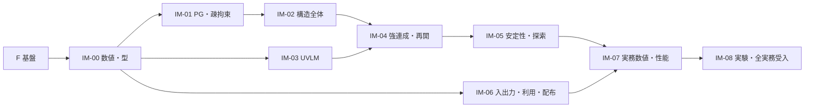

# ロードマップ

作業の順序と状態の正本。行が持つのはID、種類、題、Issue、状態だけで、完了条件はIssueに書く。行の追加と削除はGrillの後に行う。「今」を書き換えるのは、その行を終えるPRだけ。

**今**：IM02-0の開始審査と、IM03-0・IM06-0の実装

[実装中の3パッケージの進捗と残作業](plans/active-package-progress.md)で、完了段階数、レビュー中の成果、終了審査までの全工程を確認できる。

目的は、実務で利用できる品質のUVLM–ANCFソルバー。[IM-00終了審査](plans/im00-completion-review.md)に、共通数値基盤と凍結参照の製品検証を記録した。後続は[作業分解](plans/next-package-work-breakdown.md)に従い、次の3系統を並行して進める。

- **構造（IM-02）**　認定済みのPG基底、物理参照、全厚拘束と固定疎チャートをIM-01から引き継ぐ。これらを入力に、材料・質量、梁、接続、荷重、回復の開始条件を整理する。 [IM-01の終了審査](verification/IM-01/exit-review.md)
- **空力（IM-03）**　局所P1誘導核、大域幾何の適格性検査、後縁の放出所有を実装済み（#153）。次は共有・四辺形の全作用と既知流れ。採用したPCHIP時間入力の契約（#161）を実装につなぐ。循環・荷重・後流は後続で扱う。
- **入出力（IM-06）**　所有する型付きschemaとSI変換を実装済み（#154）。次は外部参照の取得と検証（契約は#159）、物理準備への接続。参照は照合した元ファイルの内容を外部形式の読取りに引き渡す。

経緯は[実装前の経緯](../rd/planning/preimplementation-history.md)、依存と受入に進む条件は[開始審査](plans/implementation-start-review.md)を参照する。

品質の仕組み（追跡、基準結果、結果の変更管理、来歴、環境の認定）は [品質保証計画](quality/quality-plan.md)、受入ケースの状態は [case-status.md](quality/case-status.md)、要求と決定がどこで試験されているかは [追跡表](quality/traceability.md) にある。

状態の語：`Todo`、`Grill後に分解`（まだ着手しない）、`In progress`、`Done`。`Done` は行の完了条件を満たしたことを指し、数値認定・実験妥当性・性能・実務受入を意味しない。それらは各パッケージのgateと、IM-07、IM-08で判定する。

## 依存

先行パッケージの完了gateが、次のパッケージの入口条件になる。IM-06の基盤の入口はIM-00の後に始められ、各物理の変換は対応するパッケージの後になる。

## F：基盤

| ID | 種類 | 題 | Issue | 状態 |
|---|---|---|---|---|
| F-1 | Task | リポジトリ基盤：R&D成果の整理、Rules／Skills、開発環境、ロードマップ | #1 | Done |
| F-2 | Task | Linux（GCC 14）とCIでビルド・試験を確認する | #2 | Done |
| F-3 | Task | 証拠の束をリリースのアセットへ置き、取得して照合する | #3 | Done |
| F-4 | Design | 公開前の判断：AVL由来のGPLファイルと絶対パスの扱い、初回push | #4 | Done |

## REL：公開の準備

公開の手順と、公開の前に成り立つべきことは `publish` の規則と [品質保証計画](quality/quality-plan.md) が定める。所有者が決める事項を先に決め、作業の自動化は配布の実装と一緒に進める。

| ID | 種類 | 題 | Issue | 状態 |
|---|---|---|---|---|
| REL-1 | Design | 公開先、対応環境、配布物の署名を決める | #26 | Todo |
| REL-2 | Task | 公開の作業を自動化する：検査のスクリプト、配布物の構築と検査、公開のワークフロー | #27 | Todo |

## IM-00：数値表現・求解・状態契約

親Issueは #16。仕様は [N4](specs/foundation/numerical-foundation-adoption-specification.md)。

| ID | 種類 | 題 | Issue | 状態 |
|---|---|---|---|---|
| IM00-1 | Feat | 固定した数値依存の機能とライセンス通知を検査する | #5 | Done |
| IM00-2 | Feat | 強いID、checked 64bit寸法、ResourcePlan | #6 | Done |
| IM00-3 | Feat | Failure／expected と ErrorCertificate | #7 | Done |
| IM00-4 | Feat | 密・CSC疎の保持、DofLayout、PointSoA | #8 | Done |
| IM00-5 | Feat | PrecisionBuffer、two-product・補償残差、TwoWordの保持と明示投影 | #9 | Done |
| IM00-6 | Feat | 密基準解法：pivot付きLU、実LU＋複素後縁更新、反復改良 | #10 | Done |
| IM00-7 | Feat | 疎基準解法：対称正定値を確かめたLLT、不定KKTのSparseLU | #11 | Done |
| IM00-8 | Feat | 固定前処理の再始動GMRESと線形精度の認定 | #12 | Done |
| IM00-9 | Feat | Model参照、AcceptedState／TrialState、Workspace、cache世代、資格と一回確定 | #13 | Done |
| IM00-10 | Feat | Python結合の所有権とエラー規約を製品の処理へ移植する | #14 | Done |
| IM00-11 | Test | IM-00の完了gate：設計試作4数値群の製品検証（密・疎のゼロ許容差修正 #62 を含む） | #15 | Done |
| IM00-12 | Feat | 計測基盤：工程別の時間、ピークメモリ、確保の検査、決定性の試験枠、kernelベンチ | #25 | Done |

依存はIssueに従う。IM00-1 → IM00-3の後、IM00-2とIM00-12を並行できる。IM00-2・3の後はIM00-4とIM00-9、IM00-3・4の後はIM00-5へ進める。IM00-4・5の後のIM00-6とIM00-7は並行し、両方の後にIM00-8を置く。IM00-3・9の後はIM00-10へ進め、IM00-1〜10の後にIM00-11でパッケージを判定する。IM00-12は最初の解法IM00-6より前に終える。行順を全作業の直列依存と解釈しない。

## IM-01 〜 IM-08

各パッケージは、着手の前にGrillを行い、行へ分解する。分解するまで実装を始めない。

| ID | 種類 | 題 | Issue | 状態 |
|---|---|---|---|---|
| IM01-0 | Feat | IM-01 PG参照係数・疎拘束 | #17 | Done |
| IM02-0 | Feat | IM-02 構造全体 | #18 | Grill後に分解 |
| IM03-0 | Feat | IM-03 UVLM | #19 | In progress |
| IM04-0 | Feat | IM-04 強連成・再開 | #20 | Grill後に分解 |
| IM05-0 | Feat | IM-05 安定性・探索 | #21 | Grill後に分解 |
| IM06-0 | Feat | IM-06 入出力・利用・配布 | #22 | In progress |
| IM07-0 | Feat | IM-07 実務数値・性能 | #23 | Grill後に分解 |
| IM08-0 | Feat | IM-08 実験・全実務受入 | #24 | Grill後に分解 |

### 最初の依存閉包

[作業分解と開始条件](plans/next-package-work-breakdown.md)に、既存3パッケージ全体の依存と停止条件を記載する。各子の式・型・資源・独立参照が揃った部分から開始し、未達の開始条件がある部分は実装しない。親の完了を主張する行ではない。

| ID | 種類 | 題 | Issue | 状態 |
|---|---|---|---|---|
| IM01-1 | Feat | PG参照準備用のexact有理数・多項式 | #87 | Done |
| IM03-1 | Feat | 有限三角形の厳密な幾何述語 | #86 | Done |
| IM06-1 | Feat | 厳格な入力ID・index変換 | #85 | Done |

### 次の依存閉包

最初の3子作業の完了を入力とし、各子の開始条件を閉じてから実装した。

| ID | 種類 | 題 | Issue | 状態 |
|---|---|---|---|---|
| IM01-2 | Feat | PG有理グラフとhalf-cell・矩形活動map | #94 | Done |
| IM03-2 | Feat | 空力の所有geometryとexact query位置式 | #95 | Done |
| IM06-2 | Feat | 元bytesと型を保持する所有入力文書 | #93 | Done |

### 後続の作業

既存親の作業分解に従って、完了済みの準備部品を使う。互いの成果物に依存しない本体は並列に進める。設計の行は、その契約の審査後に実装へ渡す。

| ID | 種類 | 題 | Issue | 状態 |
|---|---|---|---|---|
| IM01-3 | Feat | PG全原辞書とanchor補完・必須場map | #108 | Done |
| IM01-4 | Feat | PG多角形と全積分分割 | #125 | Done |
| IM01-5 | Design | PG局所独立化のexact rank・全再構成・包含契約 | #133 | Done |
| IM01-6 | Design | PG領域分割の資源予測と48GiB依存 | #136 | Done |
| IM01-7 | Design | PG局所rankの資源受入方式 | #140 | Done |
| IM03-3 | Feat | 空力局所幾何の包絡と所有する適格packet | #109 | Done |
| IM03-4 | Feat | 局所P1誘導核と全13変数微分 | #127 | Done |
| IM03-5 | Design | 大域幾何と後縁所有の開始契約 | #134 | Done |
| IM06-3 | Design | 全case schemaと段階別検証の契約 | #110 | Done |
| IM06-4 | Feat | 全caseの所有typed schemaとexact値・参照・資源検査 | #126 | Done |
| IM06-5 | Design | SI変換・入力精度・所有と変換予算の開始契約 | #135 | Done |
| IM06-6 | Feat | 所有SI入力・元exact値と成分別精度変換 | #148 | Done |

## 残リスクと止める位置

[開始審査4節](plans/implementation-start-review.md) のR-01〜07。消えた課題ではなく、該当パッケージのgateで止める課題である。

| ID | 課題 | 止める位置 |
|---|---|---|
| R-01 | S10の測定・入力・同期・幾何の不確かさ、校正履歴 | IM-08。公開元への照会は、外部送信の前に利用者が判断する |
| R-02 | 結合PGの疎拘束rank、chart分解のfill、準備費用 | IM-01の早期gate |
| R-03 | 全自由後流と全履歴P作用が支配する費用 | IM-03 〜 IM-05で実測。12時間の見込みが立たなければ再設計 |
| R-04 | TwoWord値を要する全kernelと再開の消費 | 型はIM-00で固定。各consumerは各IMで検証 |
| R-05 | 外部格子から適格な共通曲面・材料・接続への変換 | IM-06の準備gate |
| R-06 | manylinux／Windowsの配布ランタイムと新規環境 | IM-06の初期から小さいwheel／CLIで検査 |
| R-07 | 固有modeの被覆、P-CURVED-BOXの臨界区間と全数値予算 | IM-05、IM-07 |

## 初回の実務適用まで

全必須用途の `Accepted`（[受入計画A5](requirements/practical-acceptance-plan.md)）が成立するまで、公開リリースしない。部分機能の完成を理由に公開しない。配布はソース、Windows／LinuxのCLI、Python wheel。

## 範囲に入れないもの

[製品要求](requirements/product-requirements.md) と [利用者決定の台帳](requirements/project-start.md) が初回必須に含めないと決めたもの：圧縮性補正・遷音速・剥離、材料非線形（損傷、塑性）、ヒンジ・関節・自由飛行、厚みのある物体の空力干渉、確率的乱流の生成と統計評価、LCOの定量予測、破損指標と余裕率、CAD読込みと自動格子生成、専用GUI、GPUとクラスタ。
