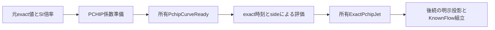

# 既知流れのPCHIP時間場：係数準備とexact評価の開始契約

2026-11-19、Issue #158、IM03-0。AE-07、FD-02/06、N4-02/03/06/08/09を具体化する。旧[統合仕様](uvlm-integrated-specification.md)と[入力field](../foundation/case-schema-fields.md)はbyte保持する。

## 1. この部品が持つ資格

対象は、一様流の三成分とgust振幅一成分がそれぞれ用いるPCHIP時間曲線である。節点・値から不変の実係数を準備し、指定時刻の値と一階微分、要求時の片側二階微分を同じ多項式からexactに返す。両曲線の節点集合が同じとは仮定しない。成分数を $$ m>0 $ 、節点数を $$ n\ge2 $$ とし、component順と各SI次元を不変descriptorへ含める。

成功型は `PchipCurveReady` と、その親を保持する `ExactPchipJet` に分ける。これは数学的な時間曲線の資格である。`SiCase`の成功から暗黙変換せず、`KnownFlow`・物理Model・C2支持運動の資格にも変換しない。constant/polynomial/expressionのTimeSeries、sine空間評価、有限精度のUVLM consumerへの投影、支持SO(3)、循環・後流は既存IM03-0/IM06-0の対応段が保持する。

元時刻と値は符号付き整数分子・正整数分母のcanonical有理数とする。零は0/1。時刻は秒、U0/aはm/sであり、ここにはdeg由来のπ倍率はない。SI recipeから分子/分母を構成するadapterは、元値・単位・成分・所有sourceを照合してから渡す。丸め済みの中心値を元exact値の代用にしない。binary64/TwoWord時刻を受けるadapterも各語のexact実値を足してから評価する。両adapterの製品化はIM06-0/IM03-0の後続で、この契約の入力は既にcanonical化したexact値である。

## 2. 採用PCHIPの実係数を一意にする

凍結AE-07試作 `rd/aero/wake-loads/experiments/uvlm_known_input.py` はSciPy `PchipInterpolator`を使う。以下は同じweighted harmonic meanと片側端点式の数学的具体化で、別のspline方式は選ばない。[SciPy公式説明](https://docs.scipy.org/doc/scipy-1.16.2/reference/generated/scipy.interpolate.PchipInterpolator.html)と[同版の実装](https://github.com/scipy/scipy/blob/v1.16.2/scipy/interpolate/_cubic.py)を参照する。SciPyのfloat丸めや既定の外挿政策を製品へ輸入しない。

各成分で $$ h_i=t_{i+1}-t_i>0 $ 、 $ d_i=(y_{i+1}-y_i)/h_i $$ とする。2点なら $$ s_0=s_1=d_0 $$ 。内部節点は、 $ d_{i-1}d_i\le0 $$ なら $$ s_i=0 $$ とし、積でoverflowを作らず符号とexact零で分岐する。それ以外は

$$
w_1=2h_i+h_{i-1},\quad w_2=h_i+2h_{i-1},\qquad
s_i=\frac{w_1+w_2}{w_1/d_{i-1}+w_2/d_i}.
$$

左端の候補は $$ z=((2h_0+h_1)d_0-h_0d_1)/(h_0+h_1) $$ 。 $ \operatorname{sgn}(z)\ne\operatorname{sgn}(d_0) $$ なら0とする。それ以外で $$ \operatorname{sgn}(d_0)\ne\operatorname{sgn}(d_1) $$ かつ $$ |z|>3|d_0| $$ なら $$ 3d_0 $ 、残りは $$ z $$ 。右端はh,dを端から逆順にした同じ式を使う。零のsignは0、clipの等号は残りの枝である。

区間の無次元座標を $$ u=(t-t_i)/h_i $$ とし、昇冪順の係数を

$$
c_0=y_i,\quad c_1=h_i s_i,\quad
c_2=3(y_{i+1}-y_i)-h_i(2s_i+s_{i+1}),\quad
c_3=2(y_i-y_{i+1})+h_i(s_i+s_{i+1})
$$

とする。保持順は `(interval,component,power)`、shapeは $$ (n-1,m,4) $ 、全係数の単位はその成分の値と同じである。内部で $$ u $$ の係数と $$ t-t_i $$ の係数を取り違えない。

$$
f=((c_3u+c_2)u+c_1)u+c_0,\quad
f_t=((3c_3u+2c_2)u+c_1)/h_i,\quad
f_{tt}=(6c_3u+2c_2)/h_i^2.
$$

係数と分岐は元exact値で決める。非等間隔、零secant、符号反転、端点clip、極小間隔も別の丸めた判定へ逃がさない。ここで返す微分は入力時刻についての物理微分であり、節点/標本値に関するslope選択算法の微分ではない。

## 3. 範囲・side・C1要求を区別する

入力は `Reject`、`Hold`、`Periodic(period)` のclosed variantであり、政策はidentityへ含める。内区間はexact比較で選ぶ。内部節点で値/一階微分はC1の共通値とする。内部節点の二階微分は左右のexact値が一致する場合に限り`Automatic`を許す。一致しなければ`Left`か`Right`を明示し、未指定はInvalidInputとする。左右を平均しない。区間内部のside指定は値を変えない。

| 政策 | 範囲と境界の意味 |
|---|---|
| Reject | 閉区間[t0,tlast]だけを受理。両端は唯一存在する内側値/微分。範囲外はInvalidInput |
| Hold | 外側は端値、外側の一階/二階微分は0。端点で必要導関数の内外値が不一致ならsideを要求し、一致時はAutomaticを許す。値は連続でも、端傾き非零ならC1資格を持たない |
| Periodic | periodの明示を必須とし、省略や節点幅からの暗黙推定を拒否する。period=tlast−t0>0をexact要求。全成分の端値と端傾きをexact照合してから受理。全有理時刻に対しq=floor((t−t0)/period)、tbar=t−q periodを[t0,tlast)へ入れる。負時刻を切捨て除算で扱わない。seamで値/一階微分は共通値、二階は左右不一致時だけsideを要求し、一致時はAutomaticを許す |

Hold端点の`Automatic`は、要求する全導関数が内外でexact一致する場合だけ受理する。たとえば値だけなら可、一階までなら端傾き0が必要、二階までなら対応する内側二階も0が必要である。Periodic seamにも二階の同じ規則を適用する。内部節点の二階Automaticは左右一致時だけ受理する。side不足はUnsupportedや任意側選択にせずInvalidInputで返す。

準備入力は用途の要求区間 `[a,b]` と必要連続性 `C1` を持つ。Rejectなら要求区間が定義域内であることを確認する。Holdの要求区間が端点を跨ぐか端点を含む場合、必要な端傾きが0でなければC1要求を拒否する。端点を含まない片側だけの要求区間はその区間で検査する。Periodicはseamを含めてC1を検査する。有限区間の端で片側だけを要求するRejectと、両側を定義するHoldを混同しない。

eventsは呼出し側が入力したexact時刻列で、厳密増加・重複なしを検査して保持する。要求区間外の宣言も失わず、実イベント選択は後続の入力接続が行う。このPCHIPは内部節点でC1のため、各節点を速度不連続eventへ自動昇格しない。イベント宣言だけでHoldのC1欠如を消せない。C2支持運動は、この部品の片側二階情報と節点集合を受けて別の準備gateで判定する。分割イベントのqueueやBDF2履歴再構成はここで行わない。

## 4. 入出力・所有・同一性

準備の論理入力は `samples{times[n],values[n,m],dimensions[m]}, outside, events, demand{interval,C1}, input_stamp, limits, workspace, ResourcePlan, diagnostic context`。borrowは同期copy完了まで不変であることを要求する。返却は不変の節点、元値、実係数、政策/期間、要求区間、events、式版を所有する。lvalue限定readonly getterだけを公開し、move元は不活性とする。入力/Workspace/Plan破棄後にも結果は有効である。

評価は `curve, expected_preparation_input, exact_time, derivative_order{0,1,2}, side, limits, workspace, ResourcePlan, context` を受け、component順にvalue/dt/必要時dttをcanonical有理数で所有する。親curveを共有保持し、選択区間・正規化時刻・元query時刻・side・式版も保持する。未要求のdttを零で偽装しない。成功型をbinary64へ暗黙変換しない。有限精度consumerは別の明示投影で誤差を認定するまで使えない。

identityは元exact節点/値・成分次元・式版・係数・outside/period・要求区間/eventsの実内容から作る。再開時はこれらを全て保持し、coefficientsだけを同じと見なさない。hashやポインタ一致だけを認定の代用にせず、restoreはcanonical性・shape・再計算した係数/境界C1を照合する。異なる節点/政策/成分順/式版/入力世代のcache再利用を拒否する。実checkpoint容器はIM06-0の後続である。

### 準備入力のissuer・世代と保存復元

[既存の内容と世代の規約](../foundation/state-contract.md)では、同じ内容fingerprintでも世代が違えば流用しない。PCHIPの準備も、入力を所有する呼出側から`PchipInputStamp{issuer_id,input_generation}`を明示的に受け取る。両欄は別のstrong tagを持つuint64値で、0も有効値である。issuerは当該準備入力の発行元を区別する安定した名前空間の識別値、generationはその名前空間内で入力を更新するたびに進む世代である。内容hash、アドレス、現在時刻や標本時刻から生成しない。既存Model::createと同様、これらを供給・管理する責任は準備hostにあり、現存しないissuer serviceを部品の内部で仮定しない。root入力schemaに利用者向けkeyを追加する意味ではない。

準備hostは同じissuer名前空間で世代を別入力へ再利用せず、更新時はcheckedに進め、overflowをResourceExceededとする。同じ準備入力の再試行は同じstampを保持できる。保存/再開後の発行元と次世代もhostが一意に管理し、保存snapshotから無検査にissuerを新設したり、旧世代を再発行したりしない。

stampは不変の`PchipPreparationInput`が元exact節点/値・次元・outside/period・要求区間/events・式版と一体で所有する。係数準備はこの入力を受け、結果とjetはそのstampを保持する。identityはこのstampを実内容fingerprintと別欄で保持する。2つのuint64欄の保持/コピー/照合もowner header・全call計画へ数える。

評価・cache再利用の`expected_preparation_input`は、呼出側の現在の準備入力から独立に渡し、curve自身から暗黙に取り出して代用しない。そのexpected stampと元入力実内容の両方を照合する。stampと内容が両方一致する場合だけ再利用でき、入力世代やissuerだけが異なる場合もStaleGenerationとする。同stampでも内容が違えばStaleGenerationで拒否する。query時刻・side・微分要求・式版の照合も省かない。

照合は各queryで全配列を走査することを必須にしない。同じ不変準備入力の所有handleを共有しており、既に認定した同じowner/stampであることを確認できる場合は、その所有同一性を使える。裸の配列アドレスや再利用され得るポインタ値だけでは判定しない。別所有のcopyにはexact実内容比較を行う。その比較を一度だけ行って再利用する実装では、両方の不変ownerとstampを保持する等値証拠を作り、その同じowner対のみに適用する。入力更新は新しい不変ownerとなるため、古い証拠を新世代へ流用できない。等値証拠の保持・比較費用も全call計画へ計上する。これは同一入力の透過的判定であり、世代や入力を無断変更する経路ではない。
保存はstampと元入力実内容、係数をまとめて保持する。restoreは保存値とは独立に呼出側からexpected準備入力を受け、まずissuer/世代/元入力の一致を確かめ、次にcanonical性・shape・係数再計算・境界C1を検査する。不一致はStaleGeneration、破損した形状/係数はInvalidInputとする。保存データへ現在stampを付け直して一致させない。同内容・同stampの別所有copyは復元できるが、同内容・別世代は復元できない。実checkpoint容器の実装は引き続きIM06-0の後続である。

## 5. exact演算を全call計画へ落とす

有理値は符号、分子/正分母の32bit limb列を持つ。入力語の先行走査はborrow不変の条件で固定整数のbit長/shape/符号・最上位語/内容hashを読み、巨大整数・snapshot・DAGをまだ確保しない。分子/分母のGCD=1という数学的canonical性は、この先行走査で計算しない。全call admissionとsnapshot copy後にGCDで検査し、非canonical入力をInvalidInputで拒否する。その全入力record分のnormalization費用Nとscratchも外側計画へ加える。入力値capと中間値capを別に持つ。個数/bit幅/limb/byte/work/添字の加算・乗算は全てcheckedにし、0を無制限としない。

式は2節の各primitiveへ非再帰SSAで展開する。counting型と数値型は同じ式定義を使い、値分岐は全枝最大、成分/区間の繰返しは個数と最大bodyで数える。比較を含む全node/中間bit幅/同時生存slot/結果容量/累積確保を確定し、admission後に初めてWorkspace/結果を確保する。`vector`でDAGを先生成して後から課金しない。

分子/分母の上界bitを(P,Q)とすると、加減は `(max(Pa+Qb,Pb+Qa)+1,Qa+Qb)`、積は `(Pa+Pb,Qa+Qb)`、商は `(Pa+Qb,Qa+Pb)`。比較には二つのcross productと差を数える。約分前の幅を中間capへ数え、GCDで小さくなると楽観しない。全枝の最大からBを求める。checkedな `carry_bits=plus(B,1)`、`word_bits=plus(carry_bits,31)`、`w=word_bits/32`、`integer_bytes=times(w,sizeof(uint32_t))` とし、分子/分母・全一時slotもこのワード丸め後のbytesで計上する。B+1は除算remainderの一時shiftの桁も含む。

整数primitiveは符号付きschoolbook積、carry付き加減、上位からの比較、bitごとのrestoring整数除算、Euclidean GCDとする。除算はB bit以下、GCDの除算回数は2B+1以下を予約する（正整数の二回の剰余で最大bit長が少なくとも1減るため）。各limb処理body/bit/ループvisitの前にworkと取消を検査する。乗算は64bitへ一語積・既存limb・carryを加えても最大2^64−1である順序を守る。

| primitiveの上界 | 課金するbodyと定義 |
|---|---|
| 整数積 M | w² schoolbook body＋clear/export/carry/importの4w：M=w²+4w |
| 整数加減 A | compare/加減/符号normalizationの最大3w+3 |
| 整数除算 D | 商/余りclearの2w、各bitのshift/compare/subtract/qbit/visit：D=2w+B(3w+3)+1 |
| 有理normalization N | GCDの2B+1商余り＋約分の2除算＋sign/zero/copy：N=(2B+3)D+4w+4 |
| 有理加減/積/商/比較 | 3M+A+N / 2M+N / 2M+N / 2M+A。copy/negateは2w+1 |

上界の各項はこの固定走査の回数でありCPU命令数ではない。早期終了したloopは実際のvisitだけを課金する。GCD/除算の余り/商/carryも同じ整数SSAで同時生存slotへ数える。1有理nodeは分子と分母の2整数slotを持ち、primitiveの整数scratchはそのDAGの最大生存slot Iとする。counting型が出すslot数と実装の最大使用数を実試験で照合する。

準備結果の有理record数は `R_prepare=n+nm+4(n−1)m+period_count+event_count+2`。末尾2は要求区間端点である。評価結果は `R_eval=m*(1+derivative_order)+2`（元時刻と正規化時刻を含む）。persistentにはrecord/shape/政策/親header、canonical limb列の実コピー、context/要求区間/identity bytesを数える。scratchには `2*S+I` 整数slot×w×sizeof(uint32_t)、sign/count metadata、検索/商余り/式計画の同時領域を数える。Sは有理SSA全slot数で、不要slotの削減は初回成立の根拠にしない。準備/評価/restoreの全計画を別々に持ち、結果と入力の保持を一回ずつ計上する。準備済みWorkspaceの数値loop中に動的確保しない。

外側計画には節点exact比較、shape/copy/identity/係数再照合、区間検索、周期のfloor商余り、全結果copyも含める。floorは負の非整数商なら整数切捨て商から1を引く。全workはopcode上界のchecked和とvisit数で、最初の演算前に予約する。計画版/bit幅/要求/入力shapeとWorkspaceを照合する。失敗後も成功したpayload課金は累積し、同じcall内の成功済み確保を返金しない。

固定limb Workspaceはallocatorを使わない。所有header/control blockとallocator metadata/RSSは別に計上し、既存のEstimateAdmissionとRequireProvenBoundを区別する。証明のないopaque費用を0にせず、証明要求はUnsupportedとする。確保bad_allocはResourceExceededへ変換する。この上界は資源admissionの定義であり、実務規模の所要時間/RSSの合格ではない。

## 6. 検査順・失敗・実装gate

入口は `lease→borrow不変下のclosed variant/shape/bit/整数語表現検査→cancel→非確保count/全call admission→確保とsnapshot copy→課金付きcanonical検査/演算→C1/境界検査→所有結果` の順である。範囲外/side不足/節点順序/不一致はInvalidInput、未知の政策はUnsupported、非有限語adapterはNonfinite、bit/byte/work不足はResourceExceeded、取消はCancelled、必要精度の未達はPrecisionUnresolved。operationはEvaluateAero。失敗は元のcause/details、既知context/成分/節点を値保持し、inner Failureを一般分類へ潰さない。

Workspaceの同時使用はInvalidInputで拒否し、失敗後leaseを解放する。入力・親curve・古い結果・前の計画は不変。取消は最後の所有header確保後にも再検査する。独立Workspaceの1/2/4threadはcanonical結果・選択side・計画/実workが一致する。callbackや利用者コードは実行しない。

| 実装完了時に閉じる系列 | 事前に固定する参照/負対照 |
|---|---|
| 全slope枝/2点/非等間隔/符号/零/clip等号 | 手計算した有理slopeと独立Hermite条件。exact値/一階/二階/積分は許容差0 |
| 元語保持/極近節点/尺度 | 1,1+2^-200の別節点、大きい共通原点、正の時刻尺度。時刻/値を先にdouble化する変異を拒否 |
| 範囲/hold/周期/side/C1 | 負時刻floor、周期seam、端値/傾き違反、左右二階不一致、hold非C1。値だけの検査へ落とす変異を拒否 |
| 所有/再開/identity | 元owner破棄、move、同shape別係数/政策/世代、壊れた係数。hashだけの受理を拒否 |
| 全call資源/失敗 | byte/work/bitの等号/1不足、checked overflow、全確保fault、cancel/再入/旧結果、private limb演算の独立整数対照、1/2/4thread |

設計witnessは式と意味を独立確認する範囲に絞る。製品C++の全allocator・Workspace・例外・Linux構成の証明には使わない。実装時は全上表、countingと実行slot/workの一致、隔離compile/link成功後の意味変異、対象D/R・静的検査・工程/資源実測を揃える。全TimeSeries/既知流れの完成や実務受入を、この部品の成功から推論しない。
