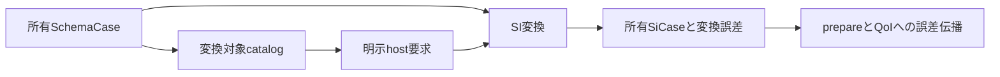

# SI変換と入力精度の実装開始契約

2026-11-18。Issue #135、IO4-01、IM06-0。採用済みの[case契約](case-schema-contract.md)、[全field](case-schema-fields.md)、[初期物理場](case-initial-physical-state-contract.md)、[typed schema](typed-case-schema-implementation-contract.md)を補う。旧資料のbytesとJSON形式は変えない。

## 1. SI変換の成功が保証する範囲

`SchemaCase → SiCase` は、元のexact値、全成分の次元・単位・軸の意味を保持してSI表現と変換誤差を所有する工程である。全191 record・806 memberの既存variantを対象にする。ID、個数、index、opcode、真偽値、文字列は物理量として換算しない。`Rational`は分子・分母を合わせた一つの値として扱う。

成功は入力変換だけの資格である。外部fileの読取り、式の数値評価・微分、SO(3)、材料SPD、活動領域、初期物理場の補完、最終q/v、物理残差、QoIへの誤差伝播はprepare以降の資格に残す。既存の12誤差群や`projection_absolute/relative`をSI変換の許容差として流用しない。CLIとJSONへ新しい指定項目を足さない。

物理予算を決める呼出し側は、変換前に3節の要求を全対象へ渡す。未指定の許容差を製品が推測しない。このhost I/Fを採用するため、設計時点で利用者に一律の数値を決めてもらう必要はない。CLIの要求構築は既存IM06-0の後続であり、host要求を作れない状態で解析成功を返してはならない。

## 2. 元値と単位倍率をexactな式で保持する

元値を $$ x $$、FD-01の次元を $$ d=(l,m,t,a) $$ とする。SIの真値は

$$
y=xU(d),\qquad U(d)=u_L^l u_M^m u_T^t c_A^a\pi^k,
\quad (c_A,k)=\begin{cases}(1,0)&\mathrm{rad}\\(1/180,a)&\mathrm{deg}.\end{cases}
$$

| root単位 | SIへのexact有理倍率（列挙順） |
|---|---|
| m, mm, cm, km, in, ft | 1, 1/1000, 1/100, 1000, 127/5000, 381/1250 |
| kg, g, t, lbm | 1, 1/1000, 1000, 45359237/100000000 |
| s, ms, min | 1, 1/1000, 60 |
| rad, deg | 1, π/180 |

`SiExactRecipe`は元Numberの符号・全桁・10進指数、または元Rationalの両整数、root単位の型別enum、次元、πの整数冪を所有する。元の字面と正規数値を別に保持する。`-0`の字面も失わない。次元は既存のint16、π冪の絶対値は安全な符号拡張後に求める。式DAGの`integer_power`はint32のopcodeであり、SI工程で実行したり単位冪へ流用したりしない。

有限10進数は数学的には有理数だが、その巨大整数の実体化は無条件に行わない。`materialize_rational(recipe, ExactLimits, ResourcePlan)`はπ冪が0、または元値がexact零の場合だけ許す。10冪の必要bit数、分子・分母・交差積と全workをcheckedに事前計画し、cap内の場合に限り既存`ExactRational`を構築する。非零のπ因子を有理数やbinary64から回復した有理数へ置換しない。零は0/1へ実体化できる。

### 全consumerで一度だけ換算する

| 対象 | SIへ渡すもの／後段へ保つもの |
|---|---|
| 通常のQ、固定配列、行列 | 各成分の採用次元。densityはM/L³、pressureはM/(LT²)。相対許容差は無次元 |
| material/world/current位置、時刻 | 位置はL、time・eventsはT。domain chartのs/t/ζは無次元。梁sだけL、剛体点3成分はL |
| Frame・初期状態 | origin/変位/速度/角速度の採用次元を換算。回転行列、軸の向き、body/world、R/P/C、明示されたhalf-cell情報、片側traceを保持。回転・直交化・場の評価はしない |
| ひずみ・材料 | Green/Mandel/engineering成分と順序を保持。beamのΓは無次元、κは1/Lで角度単位を掛けない。K6/粘性はFD-04の成分別次元 |
| 支持K/D | 行列要素の角度冪−1/−2も換算。一般化変位倍率D、仕事倍率uEに対しKsi=uE D⁻ᵀ Kraw D⁻¹を成分別に実現する。dampingは時間倍率も採用次元から得る |
| PG幾何 | exactなchart・domain・多項式係数は無次元のrecipeを保持。reference_length・実厚さはL。投影値からexact述語を再構成しない |
| RF/TimeSeries | polynomialのoutput係数はconsumer次元、origin/lengths/domainは宣言座標の次元。time origin/scale/domain/times/eventsはT。正規化座標比の単位を二重に掛けない |
| Expression | constantを各nodeの宣言次元で換算。domainはchart無次元／位置L／time T。後段評価のvariable入力は既にSI。sin/cosへの角度はradになるが、関数値・微分は未評価 |
| 観測・尺度 | reactionのforce/moment、firstPK9と他stress6、材料成分順、modeの1/Tとangleを区別。ConstraintScalePolicyの位置L・姿勢angleを維持。両側interfaceを平均しない |

次元なしに見えるRationalにもconsumerからの型付けを用いる。191 recordの全数値fieldから上表のrole、次元、基底へ到達するdispatch表を実装し、未登録roleを黙って無次元にしない。

単位倍率は正である。元exact値で確定したdomain端点・層端点・eventsの順序を保持し、同じ投影値になってもsort、結合、snap、削除しない。後段演算が分離した数値境界を要するとき、包絡が重なる場合は要求精度の再構築または`PrecisionUnresolved`とする。丸めた中心の順序で元の区間を潰さない。

## 3. 許容差はSI尺度で無次元化して明示する

各変換対象に、同じ次元の正のSI尺度 $$ s $$、無次元の $$ a\ge0,r\ge0 $$ をexact Decimal/Rationalで要求する。変換された中心を $$ c $$、真値包含から証明した上界を $$ E\ge|y-c| $$ とすると、受理条件は

$$
E\le as+r|y|.
$$

これは絶対項をSIの $$ as $$ に固定した式である。尺度やa/rの既定値は置かない。全て零の許容幅はexactに表現できる場合だけ受理する。包絡で検査するときはEの上端と右辺の下端を比較する。右辺の上端、丸め上げた許容幅、中心だけから作った相対項では合格にしない。要求値の演算丸めも判定用包絡に含める。

`SiRequirement`はcatalog内の全論理数値に各1行必要である。同じ数量への重複、欠落、別catalogのkey、尺度の次元不一致、非正尺度、負のa/rは`InvalidInput`。同じ物理場への複数参照は元fieldの同じkeyを参照する。異なる元fieldは値が同じでも別keyである。

入力誤差のledgerはkeyごとに一つの起源を作る。π包絡・10進取込み・unit積・中心丸めを合わせてEへ含め、πの寄与を後からもう一度足さない。後段の感度・使用回数による伝播は必要であり、参照の共有を理由に伝播を省略しない。中心の二語→一語投影では新しい丸めだけを加え、既存Eを保持する。QoIの既存誤差群への帰属と合計はprepare以降が行い、converter単体はQoI予算の達成を主張しない。

## 4. 包含演算と保持形式を固定する

元値を先にdoubleへparseしない。端点は256有効bitの符号付き整数仮数とint64の2進指数で表す。整数kernelはallocatorなし・checked固定1024bit、式templateなしとし、加減乗除を外向きに丸める。積は最大512bit。除算は256bit以下の分子全体へ最大513bitを追加shiftし、最大769bitの整数商と剰余から256bitへ丸める。加減算の仮数整列はshift後768bit以下に限定する。指数差でこれを超える場合は大きい側を基準格子へ置き、捨てる小さい項の正負に従って下端は前の格子点、上端は後の格子点へ外向きに拡張する。零の小項だけ拡張しない。比較もvirtual-zeroで行い、巨大shiftを作らない。丸め・比較temporaryを1024bit内に保ち、int64の差・和・符号反転もcheckedに扱う。負の最小値を直接negateしない。

10進仮数は全桁を順に取り込む256bit区間の`10*v+digit`で評価する。10進指数・有理分母・unit冪は二乗反復法で区間倍率へ変換する。指数の絶対値に比例するループや`10^e`の巨大整数を作らない。exponent/int64または固定仮数の表現能力を超えたら`PrecisionUnresolved`とし、零・無限大の成功にしない。256bitは内部の固定演算精度であり、任意に厳しい要求への成功保証ではない。

πはMachin式 $$ 16\arctan(1/5)-4\arctan(1/239) $$ を使う。それぞれ交代級数128項と次項剰余の有理上界を外向き区間で評価する。項数、演算順、丸め規則を固定し、標準ライブラリのπやatanのULP保証へ依存しない。call内に一度だけ計算し、可変global cacheを持たない。元exact値とπ因子のrecipeは近似区間とは別に残す。

出力は`ScaledBinary64`または`ScaledTwoWord`である。

$$
y\in 2^q[h+\ell-\rho,\ h+\ell+\rho],\quad q\in\mathrm{int64},\quad \rho\ge0.
$$

h/ℓ/ρは有限binary64、単語はそれぞれを保持し、和をdoubleへ潰さない。一語ではℓ=0。非零中心は $$ 1\le|h+\ell|<2 $$ に正規化し、零中心はq=0とする。半径もそのqに対応する。全零だけ特別にh=ℓ=ρ=0,q=0。tiny/hugeな有限入力を扱うためqを常にconsumerへ渡し、既存の指数なし`PrecisionBuffer`へ暗黙変換しない。

区間中点のhiをnearest-even、exactな残差のloをnearest-evenで選び、元区間の両端からの距離を上向きにρへ包む。丸めは整数のguard/round/stickyとbit構築で行い、FP丸めmodeやFTZへ依存しない。中心が±2へ丸められたらqを1増やし、h/ℓ/ρを1/2倍する。丸め後の非零中心が絶対値1未満ならqを1減らして2倍する。いずれもqをcheckedに更新し、半径の再丸めは上向きに行う。再正規化後に包含と許容幅を再検査する。

まず一語、同じ要求に届かなければ二語を試す。有理倍率での零許容は別のexact経路を持つ。π冪0または元exact零について、2節のcap内で有理化・約分し、分母が2冪で、選んだ一語／二語中心にexact一致することを整数で証明できればρ=0にできる。`0.1 km=100 m`、`500 mm=1/2 m`をこの経路で必ず受理する。逐次区間の残幅だけを理由に拒否しない。必要なexact temporaryがcapを超える場合はそのcapを示して`ResourceExceeded`。非dyadicの`1.20 in`は零幅にしない。二語でも届かない場合や半径を保持できない場合は`PrecisionUnresolved`。中心がexact零でも非零半径がある場合にq=0で半径を保持できなければ失敗する。消費先の範囲不足も暗黙underflowで吸収しない。

## 5. 所有I/Fと検査順

以下は実装を拘束する型と責務である。利用者向けコメントは、単位、所有、失敗と使い方を英語で説明する。

| 型・処理 | 契約 |
|---|---|
| `SiCatalog`／`make_si_catalog(const SchemaCase&,limits,plan,slot)` | move-only所有。全対象のkey、元field/成分、次元、role/基底と元exact値を列挙。元SchemaCaseを借用しない |
| `SiQuantityKey` | catalogが発行し外部からordinalを作れない。source identity（SourceId/bytes/SHA、schema版）と元field/type/component/roleを照合。数値の同値だけでsourceを同一視しない |
| `SiRequest`／`make_si_request(catalog,rows,limits,plan,slot)` | exactなs/a/rを所有。全対象一対一、正尺度/非負・次元/identityを構築時検査。元rows/catalogの寿命から独立 |
| `convert_case_to_si(schema,catalog,request,limits,plan,slot)` | 全数量を認定してからmove-only所有`SiCase`を返す。Result、noexcept、const lvalue親。schema/catalog/requestの完全identityを入口で照合 |
| `SiCase::source_case()` | 結果自身が所有する元SchemaCaseのconst lvalue view。全191 typed record・参照・presenceを保持し、元caller破棄後も利用できる |
| `SiCase::quantity(field)` | 自身のsource_caseから得た数値fieldだけを受け、型付きSI viewを返す。別ownerの同ordinal、元callerのfield、不適合型を拒否。任意JSON取得口を作らない |
| `SiQuantityView` | exact recipe、次元、role/軸、scaled center/radius、要求とledger起源の読取り専用view。親破棄・移動でborrow失効、rvalue親からviewを作れない |
| `materialize_rational` | 2節の限定されたexact出力。SI浮動中心からの再有理化ではない |

SchemaCaseの所有複製は既存保持構造をprivateにclone/rebindする。再parse、再schema検査、元入力からのlazy読取りはしない。SiCaseは元schema snapshot、変換配列、source-node→SI行の平坦index、要求、ledger、解決済み既定値を所有する。公開成功型に未変換値や汎用bagを入れない。source_caseは元単位であることを型名とAPI文書に示す。

検査順は移動元/identity/host要求→checked全call計画→予約→元値取込みと単位包絡→一語/二語選択と全許容幅→所有返却。catalog/request構築も全callの資源契約を持つ。失敗時に部分SiCaseを返さず、入力・request・以前成功結果を変更しない。独立plan/slotのcallは並行利用できる。同じplan/slotの重なった呼出しと再入はcallerの禁止条件であり、runtime guardの存在を認定した意味ではない。

既定値は構造上の不在だけを解決する。provenance不在は空の補足情報と`provenance_missing`を記録する。initial/restartの不在は既存analysisの排他・必須条件を保持し、静的やflutterへ架空の零状態を作らない。材料・密度・荷重・減衰・精度・尺度・予算・resource値を追加補完しない。元presenceと解決結果を別々に保持する。

## 6. 全callの容量を確保前に計画する

全capは明示host指定であり、無制限の既定値を置かない。sourceのnode/member/桁/深さ、数量数K、要求のtoken bytesと桁、各正規指数の絶対値、π/単位冪、計画payload P、scratch S、累積owned bytes、work、diagnostic path bytesを個別に制限する。元InputQuotasは維持し、SI用host capをJSONの19項へ混ぜない。64bitの件数・積・和・offsetとhost size_tへの変換は全てcheckedである。

N=元node数、K=論理数量数、C=要求に保持する文字bytes、D=最大木深さとする。Pcloneは元SchemaCase cloneの実buffer容量と全element型の実sizeofを積み上げた量である。SIの容量表は以下で固定する。

| owned buffer | 容量 |
|---|---|
| cloneとowner header | Pclone + sizeof(SiStorage) |
| source-node→行index | N × sizeof(SiRowIndex) |
| SI数量／exact recipe／ledger | K × sizeof(SiQuantityRecord)。source scalarはcloneへの内部indexで重複文字を保持しない |
| host要求 | K × sizeof(SiRequirementRecord) + C。小数・整数・分母の全文字を含む |
| source/既定値・単位metadata | sizeof(SiSourceMetadata) + sizeof(SiResolvedDefaults)。可変provenanceはclone内だけ |

catalogのPはsizeof(CatalogStorage)+K×sizeof(CatalogEntry)+元exact文字bytes、requestのPはsizeof(RequestStorage)+K×sizeof(RequirementRecord)+Cである。3callのowned費用をResourcePlanの累積へ一度ずつ課金する。同じarena共有sliceを重複計上せず、実際に複製するbufferは両方計上する。control block/allocator overheadをpayload保証と混同しない。

scratchは命令列方式で数える。primitiveを整数仮数丸め、端点add/mul/div、区間add/mul/div、十進1桁取込み、冪1bit、π1項、出力丸め、許容幅比較の順で非再帰のSSAへ展開し、1命令の全結果を1slotとして保持する。条件分岐は全枝の最大、繰返しは入力/累積slotを残して同じbody slotへ戻す。bodyを指数値回数で展開しない。各primitiveの命令数から整数slot I、端点slot B、区間slot Jの最大をcheckedに算出する。製品は同じ定義をcounting型で展開し、式版と計画identityを検査する。

$$
S=I\,\mathrm{sizeof}(\mathrm{FixedInteger1024})+
B\,\mathrm{sizeof}(\mathrm{Bound256})+
J\,\mathrm{sizeof}(\mathrm{Interval256})+
D\,\mathrm{sizeof}(\mathrm{WalkFrame})+
L_{path}+\mathrm{sizeof}(\mathrm{SiScratchHeader}).
$$

整数backendの自動temporaryもprimitiveのslot内訳へ含め、呼出し先をsource監査して上限を記録する。根拠のない固定slot数や「必要に応じ確保」でSを置換しない。π計算、巨大指数、decimal stream、誤差比較で共有するscratchは同時最大だけ計上する。Lpathは元keyのJSON Pointer escape後の最長path bytesで、先にchecked走査して求める。clone、index、各配列・文字、walkと診断領域は別々の明示bufferであり、reserveによるcapacity増分も実容量で課金する。

workは元node/member/byteの走査1単位、区間基本演算1回、区間外の整数基本演算・比較1回、出力丸めのbit候補1回とする。固定backend内部を二重課金しない。十進C桁にはC回のbody、冪にはabs指数のbit数（int64で最大64、int16で最大16）、πは2×128項と剰余、B64/TWの両試行と要求比較を含めた命令costを全call admissionへ足す。各node、桁、冪bit、級数項、bit候補の処理前にworkと取消を検査する。予定Wと実W、P/Sと実容量をreportへ残す。予測時間やRSSの証明とは扱わない。

外部・allocator費用はEstimateAdmissionとRequireProvenBoundを分ける。後者はclone/control/backendを含む上界の証明がない環境で`Unsupported`。bad_allocやchecked容量超過は`ResourceExceeded`、表現能力・許容幅不足は`PrecisionUnresolved`、非零πのexact有理出力は`PrecisionUnsupported`、取消は`Cancelled`とする。誤ったidentity/要求は`InvalidInput`。既存のより具体的な原因は保持する。

診断slotには所有key/source/type/component/role、要求、失敗capまたは到達した包絡を置く。path構築だけが失敗した場合、元failure/code/keyを維持しpath未構築を記録する。slotなしでも同じ元failureを返す。失敗した自身の予約だけを戻し、planの累積費用を巻き戻さない。

## 7. 実装へ渡す検証と開始判定

設計oracleはstdlibのFractionだけで単位倍率、Machin剰余、正尺度判定と近接exact端点を検査する。製品の256bit kernelやAPIを呼ばず、製品合格数へ転記しない。

| 製品で必要な系列 | 観測と独立期待 |
|---|---|
| 全dispatch | FD/初期追補由来191/806 inventoryから全数値roleを独立列挙。全単位enum、全variant、混合成分、R/P/C、明示half-cell/PointCheck、native整数の非換算を検査 |
| 有理・π | 全有理単位の手書きFraction、180deg/360deg/負冪/零、π剰余の別高精度有理評価、κと支持角度負冪。mat/world/chart/time式とconstantの二重換算拒否 |
| 精度境界 | 1+1e−30、1e±400、int64指数両端、raw先頭zero、負零、normal/subnormal境界、hi/lo相殺、a/r/sの等号と1ulp隣接。真値・中心・半径を別々に照合 |
| 順序・所有 | 近接domain/eventが同じdoubleになっても元順序保持。foreign key/field、移動元、元入力/request/catalog破棄、二つの独立並列callを全payload照合 |
| 資源・失敗 | 全cap等号/1不足、全実確保点故障、桁/冪/π/診断途中取消、累積保持、path故障。計画/実P/S/Wを独立件数と照合 |
| 誤差ledger | 共有元field一起源・異なる元field別起源、πの二重加算なし、二語投影の新規損失だけ追加。QoI認定を成功型へ混ぜない |

隔離controlがcompile/link/試験成功した後、単位逆転、degを有理化、角度をκへ付与、末尾桁消去、半径除去、相対許容幅の上端使用、イベント結合、foreign ordinal受理、入力誤差二重課金、work前検査除去を各々入れ、compile/link成功後の試験失敗で検出する。クラッシュやcompile失敗を検出成功に数えない。

本契約と限定oracleの独立レビュー後、SI変換パッケージを実装開始できる。製品source、全所有/資源/故障/変異、対象D/R・Linux sanitizer・静的検査を経て初めて実装適合を判定する。SI入力誤差のQoI伝播、外部snapshot/import、prepare、CLI、全物理受入は既存IM06-0等の後続であり、この設計の完了に含めない。
