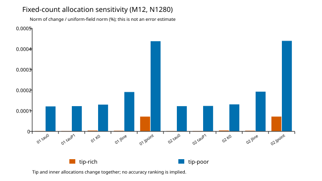

# 固定総パネル数での配分感度：実施結果

2026-10-31。[事前仕様](avl-tip-redistribution-experiment.md) と [実行追加仕様](avl-tip-redistribution-execution-addendum.md) に従い、両翼の4ケースを実行した。M12・物理N1280・半翼640帯・7680未知数を固定し、一様配分の既存結果と比較した。

## 1. 実行と保存

[準備済み入力](avl-tip-redistribution-preparation.json) のSECTION分割だけを変更した。物理断面、弦分割、cos分点、核、基準量、同じKSMAX修正版の実行体は保持した。正側10区間の一様64に対し、tip-richは内側8区間48・外側2区間128、tip-poorは内側72・外側32とした。

| 翼 | 配分 | 時間 | ピークRSS bytes |
|---|---|---:|---:|
| FW-V01 | tip-rich | 101.87秒 | 3,433,132,032 |
| FW-V01 | tip-poor | 99.36秒 | 3,433,582,592 |
| FW-V02 | tip-rich | 103.41秒 | 3,433,390,080 |
| FW-V02 | tip-poor | 100.03秒 | 3,433,562,112 |

[実行記録](avl-tip-redistribution-runs.json) の合計は412.65秒。各300秒・計1200秒・群RSS5GiB・空きとswapの条件内だった。元出力の圧縮済み保存量は49,780,296 bytes、派生場を含む合計は109,336,508 bytesで128MiB以内。

計測前後の8出力を各ケースで比較した。after一組はZIPに無損失保存し、全32内部ファイルを独立監査でoutとバイト一致させた。ZIP検証後に新規afterの重複実体だけを除去し、元出力と既存実験は保持した。[監視試験](avl-tip-watchdog-result.json) は境界値・拒否・実プロセス群停止を含む。

## 2. 6場の処理検査

[後処理](avl-tip-redistribution-result.json) は基準2場と新規4場を区別した。実際の区間別帯数、640帯・7680未知数、物理全翼15360パネルを確認した。元残差は最大相対5.978443e-12。荷重／元点モーメント保存、帯の独立集計、6場対の差の上限と地域の二乗加算を含む7処理条件が全て成立した。後処理は11.86秒、ピーク193,044,480 bytes。

上限は二つの保存場の差に対するもので、連続解への誤差上界ではない。以下の荷重値は迎角に関する静的一次係数で、有限迎角のFT係数の保存検査とは区別する。

## 3. 一様配分に対する応答

表は差の重み付きノルム／同じ翼の一様M12N1280のノルム。値が小さいことは真の解に近いことを意味しない。

| 翼・配分 | τ帯平均 | τ帯P1 | K帯平均 | 有限辺モーメント | 元点モーメント |
|---|---:|---:|---:|---:|---:|
| FW-V01・tip-rich | 3.19187e-06% | 3.28591e-06% | 5.25683e-06% | 4.64318e-06% | 7.28399e-05% |
| FW-V01・tip-poor | 0.000122511% | 0.000123691% | 0.000131259% | 0.000192228% | 0.000438363% |
| FW-V02・tip-rich | 3.39846e-06% | 3.49242e-06% | 5.71103e-06% | 4.80866e-06% | 7.29557e-05% |
| FW-V02・tip-poor | 0.000123574% | 0.000124766% | 0.000132301% | 0.000194076% | 0.000440096% |

| 翼・配分 | 揚力傾斜の符号付き差 | 元点モーメント傾斜の符号付き差 |
|---|---:|---:|
| FW-V01・tip-rich | -7.39685107e-08 | -6.68395816e-07 |
| FW-V01・tip-poor | -3.31829700e-06 | +1.01551902e-05 |
| FW-V02・tip-rich | -8.00180660e-08 | -6.61573722e-07 |
| FW-V02・tip-poor | -3.33913432e-06 | +1.01798552e-05 |

## 4. 高密度／低密度配分の方向と寄与

次の余弦はtip-rich−一様とtip-poor−一様の差の方向。一様格子を基準に反対へ応答するかを表し、真の解に向かう方向は示さない。

| 翼 | τ帯平均 | τ帯P1 | K帯平均 | 有限辺モーメント | 元点モーメント |
|---|---:|---:|---:|---:|---:|
| FW-V01 | -0.170897 | -0.164640 | 0.010365 | -0.412852 | -0.887265 |
| FW-V02 | -0.173212 | -0.167771 | -0.002467 | -0.416945 | -0.886552 |

地域の二乗寄与は、基準と同じ根元4帯・中間12帯・翼端4帯へ分けた。次表は各配分差の二乗ノルムに占める翼端側の割合。

| 翼・配分 | τ帯平均 | K帯平均 | 元点モーメント |
|---|---:|---:|---:|
| FW-V01・tip-rich | 24.888% | 2.781% | 88.983% |
| FW-V01・tip-poor | 90.246% | 95.139% | 98.573% |
| FW-V02・tip-rich | 23.982% | 2.817% | 88.904% |
| FW-V02・tip-poor | 90.294% | 95.164% | 98.562% |

## 5. 元点モーメントの補正偶力の項

[事後の追加仕様](avl-tip-couple-diagnostic-addendum.md) で、保存済みの元点モーメント差を有限辺の項と補正偶力の項へ分解した。[成分診断](avl-tip-couple-component-result.json) は6組で再構成を確認し、最大絶対差は1e−12以内。次の値は各成分ノルム／元点差ノルムであり、交差項があるため足して1になる割合ではない。

| 翼・配分（一様との差） | 有限辺の項／元点差 | 補正偶力の項／元点差 |
|---|---:|---:|
| FW-V01・tip-rich | 0.063745 | 0.943525 |
| FW-V01・tip-poor | 0.438514 | 0.597710 |
| FW-V02・tip-rich | 0.065912 | 0.941725 |
| FW-V02・tip-poor | 0.440986 | 0.595092 |

tip-richの元点差では補正偶力の項のノルムが元点差ノルムの約0.94倍に相当し、有限辺の項は約0.064〜0.066倍だった。これは保存観測上の分解であり、補正偶力の変更には循環と作用点の両方が関係する。幾何だけの原因や真の誤差と断定しない。

tip-richでは、有限辺モーメントの帯間相殺比はFW-V01で約0.00367、FW-V02で約0.000760となった。総量差が極小でも分布差は非ゼロであり、総量だけで判断しない。

## 6. 判定と残る切分け

[独立成果物監査](avl-tip-redistribution-artifact-audit.json) は入力・実行体・原本・ZIP・派生場のハッシュ、時間・メモリ・保存量、実区間配分、Decimalでの差ノルム、方向余弦と係数差を再検証した。結果図の数値とハッシュは [報告記録](avl-tip-redistribution-report.json) に保持した。

今回の比較では翼端と内側の帯数を同時に変えている。観測された応答を翼端だけの因果効果、精度改善率、真の解への距離と呼ばない。また非相似格子のため、Richardson次数や尾部推定を返さない。M12の診断でM24の合算誤差予算を補完しない。参照全体の受入、UVLAS対参照の一致、J1と製品数値コアの開始は未完了。

tip-richのτ応答は基準ノルム比で約3.2〜3.4e−8と小さい。残差が条件内でも、それだけではこの微小応答の前進誤差上限を与えない。次は [対称縮約下の循環・荷重求解感度](../symmetric-reference-solve-sensitivity-design.md) の写像・処理・回帰と資源仕様を具体化して検査し、その後に内側と翼端を独立に変える対照を設計する。
