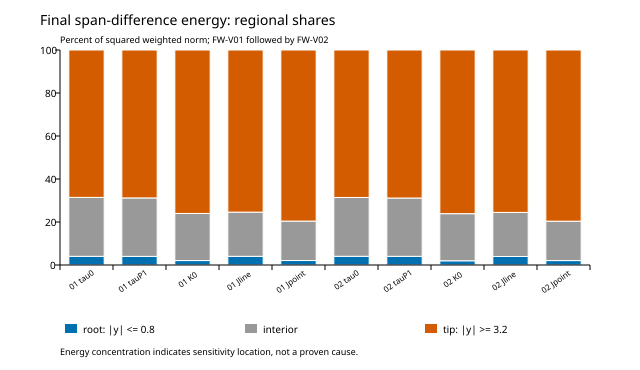
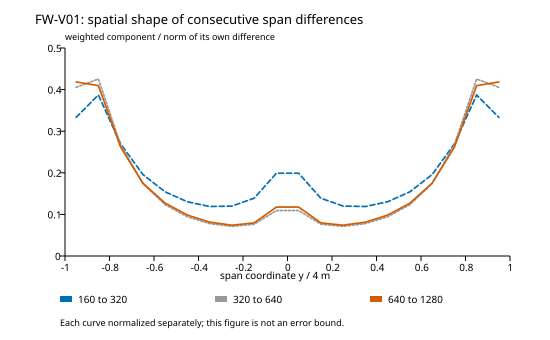

# スパン次数変動：保存データによる切分け結果

2026-10-31。[事前仕様](avl-span-order-diagnostic-experiment.md) に従い、N160／320／640／1280の同じ容量版・M24・両翼の保存データを診断した。追加AVL計算は0件。帯間の正負相殺では今回の次数変動を説明できず、最終差の約69〜80%の二乗寄与が翼端側に集中した。ただし原因の特定には至っていない。

## 1. 検査範囲

[診断結果](avl-span-order-diagnostic-result.json) は5チャンネル×2翼、3種類の総荷重×2翼を保持する。既存のノルム・次数の再現、帯の二乗寄与、元点モーメントの物理成分分解、モデル予測の独立照合を含む8処理検査が成立した。既知の2項列・符号反転・未モデル化項などの製造9件、拒否4件も成立した。

[独立監査](avl-span-order-diagnostic-artifact-audit.json) では70桁Decimalと別の漸化式で予測を照合し、最大絶対差8.68e−19以内だった。これは診断処理の検証であり、実流れの誤差モデルの正しさを示すものではない。

## 2. 総荷重の帯間相殺はない

各帯の細格子−粗格子の符号付き差を合計した。揚力・有限辺モーメント・元点モーメントの全18比較で相殺比は1だった。

$$
\chi=\frac{\left|\sum_b\Delta C_b\right|}{\sum_b|\Delta C_b|}=1.
$$

今回の帯ごとの差は全て同符号であり、総量だけが帯間の正負相殺で小さくなったわけではない。帯内の相殺や異なる物理項の相殺まで否定してはいない。

例えばFW-V01のN640→1280の元点モーメント差は、次の成分から再構成できる。合計は直接集計と一致した。

| 物理成分 | 係数差 |
|---|---:|
| τの位置重み（帯1次モーメントを含む） | −5.23019221e−5 |
| Kの項 | +1.65268011e−5 |
| 元作用点への補正偶力 | −7.06728127e−6 |
| 合計 | −4.28424023e−5 |

ここには異なる物理成分の相殺がある。したがって「相殺が全くない」とは結論しない。今回否定できるのは総荷重差の帯間正負相殺という説明である。

## 3. 差の空間的な所在

根元は帯中心の絶対値0.8m以下、翼端は3.2m以上とし、それぞれ4帯、残る12帯を中間とした。以下はN640→1280の重み付きノルム二乗に占める翼端4帯の割合。空間全体への寄与率であり、真の誤差や最大点誤差ではない。

| 観測量 | FW-V01 | FW-V02 |
|---|---:|---:|
| τ帯平均 | 68.56% | 68.60% |
| τ帯P1 | 68.80% | 68.85% |
| K帯平均 | 76.02% | 76.12% |
| 有限辺モーメント密度 | 75.41% | 75.54% |
| 元点モーメント密度 | 79.57% | 79.62% |

FW-V01のτ帯平均では、前の差の方向に直交する成分の割合が22.40%から3.39%へ減った。最後の差の形は前の差と近い一方、振幅比から得る次数は2.39→3.45へ変わっている。τ帯平均の20帯は全て同符号を維持し、最後の局所次数は約3.35〜3.51だった。単一帯の符号反転だけが全体の次数を変えたという説明とも一致しない。他の観測量の局所挙動はJSONに分けて保持した。

図は各曲線を自身の差ノルムで正規化している。振幅の小ささや未知の連続解への誤差を表していない。[図の保存値・生成元](avl-span-order-figures.json) も保持した。

## 4. 2項モデルでは十分に説明できない

4格子の値を使い、最初の2差だけから係数を決めて3番目の差を比較した。固定した4モデルはh／h²、h²／h³、h²／h⁴、h²／h²log₂h。基準幅は160/Nである。独立の予測演算は次の漸化式でも確認できる。

$$
d_j=A r^j+B s^j
\quad\Longrightarrow\quad
d_2=(r+s)d_1-rs\,d_0.
$$

log項の重根の場合はr=s=1/4に対応する。同じ式を極限値の推定には使っていない。

下表はFW-V01の分布ベクトルに対する予測残差ノルム／実際の最終差ノルム。**解の相対誤差ではない。** 実流れのモデル残差に合否しきい値は設けていないが、これらのモデルが最終差を精密に再現しているとは扱えない。

| 観測量 | h／h² | h²／h³ | h²／h⁴ | h²／h²log₂h |
|---|---:|---:|---:|---:|
| τ帯平均 | 163.4% | 141.8% | 156.2% | 127.1% |
| τ帯P1 | 164.0% | 143.8% | 158.1% | 128.9% |
| K帯平均 | 264.3% | 169.5% | 174.9% | 180.2% |
| 有限辺モーメント密度 | 89.2% | 140.4% | 153.2% | 117.1% |
| 元点モーメント密度 | 72.0% | 113.7% | 124.2% | 94.8% |

FW-V02も約73.0〜261.8%だった。総元点モーメントだけならh／h²モデルの残差は約19.1%（FW-V01）まで下がるが、分布では72.0%が残る。総量に比較的合うモデルを、そのまま分布や尾部の説明へ昇格させない。今回の4モデル以外を排除したわけでもない。

製造例では、反対符号のh項とh²項だけでも見かけの次数が増え、その次の差が符号反転する列を正確に再現した。従って次数増加だけで高次収束への移行を断定できない。また、今回の4点で0だが極限で1となる既知多項式も検査した。極限を定めるには物理問題の正則性・離散化等の追加仮定が必要であり、有限データへの当てはめだけで尾部を保証しない。

## 5. 次の切分けと準備した4入力

翼端側への寄与集中を受け、次は [総パネル数を保つ配分感度試験](avl-tip-redistribution-experiment.md) を行う。M12・N1280の既存基準を使い、正側10区間の配分を変更する。

| 配分 | 内側8区間 | 翼端側2区間 | 半翼帯数・未知数 |
|---|---:|---:|---:|
| 基準（既存） | 64ずつ | 64ずつ | 640帯・7680未知数 |
| tip-rich | 48ずつ | 128ずつ | 同上 |
| tip-poor | 72ずつ | 32ずつ | 同上 |

[両翼分の4入力](avl-tip-redistribution-preparation.json) は作成・監査済み。物理断面、分点方式、総パネル数と実行体を保持する。実行は次の作業であり、今回は未実施。逐次・各300秒・計1200秒・群RSS5GiB・開始有効空き8GiBの別診断予算と、保存・残差の検査を固定した。

これは一様な相似細分化ではなく、翼端の分割増加と内側の減少が同時に起こる。真の解への改善率やRichardson尾部を求めず、M12からM24の誤差予算を補完しない。翼端が原因と断定せず、配分に対する応答を切り分ける。

N1280の揚力・帯分布・モーメントの合算誤差予算は未評価のまま。参照全体の採用、UVLASとの一致、J1および製品数値コアの開始判定は更新していない。
